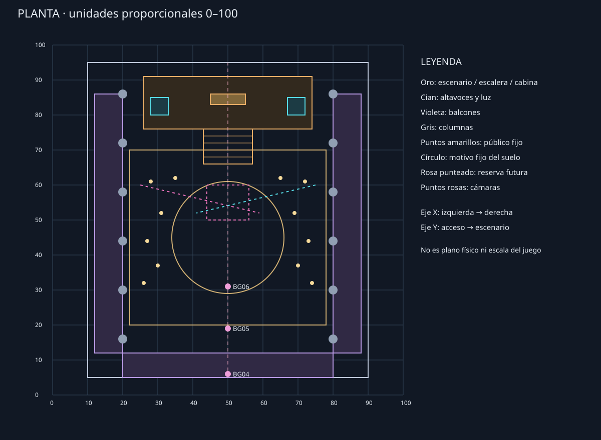
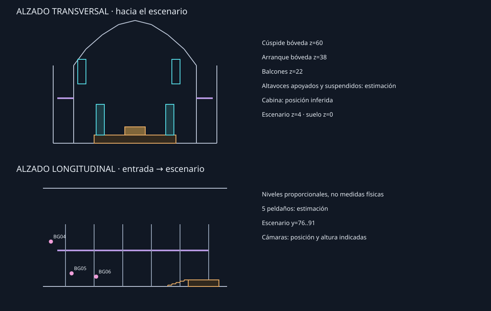

# Fase 08C.2 — Plano maestro espacial de la discoteca

**Estado: propuesta de producción pendiente de aprobación; no es geometría del juego ni modifica BG04.** El plano proporciona una sola distribución para producir los futuros fondos; las tres imágenes 08C/08C.1 existentes **no** son proyecciones exactas de ella. [Abrir galería del plano y cámaras](FASE_08C2_GALERIA_PLANO.html).

## Fuente de verdad y método

`assets/cinematics/spatial_08c2/plan.json` define posiciones, tamaños y cámaras; `tools/generate_cinematic_08c2.py` define la geometría esquemática común y la proyección perspectiva. Ejecutar `python3 tools/generate_cinematic_08c2.py` regenera la planta, los alzados y las tres vistas SVG a partir del mismo modelo, sin modificar fondos. No son imágenes de producción ni capas cinematográficas: son diagramas de líneas, sin superficies opacas, oclusión física, texturas, distorsión de lente ni luz volumétrica. Las líneas posteriores pueden verse a través de las delanteras; esto no demuestra visibilidad real.

La referencia visual es `assets/cinematics/backgrounds/definitive/scene_04_main_hall/master.png`, conservada sin cambios. Las dos vistas 08C.1 se usan solo para comparar. Las formas elegidas para resolver sus diferencias son decisiones **propuestas**, no mediciones extraídas de BG04. No se generaron fondos nuevos ni se modificaron imágenes existentes, sprites, manifiesto de producción, controlador, HUB o run.

## Convención proporcional

Cada eje usa una referencia de **0 a 100**, no metros ni unidades del motor:

- `x`: ancho; 10 a 90 es el interior de la nave; izquierda/derecha se entienden mirando al escenario.
- `y`: longitud; acceso y parte posterior cerca de 5; cabecera del escenario hacia 95.
- `z`: altura; el suelo de la sala es 0. El eje longitudinal es **x=50**. La planta se lee con y creciente hacia arriba.

## Distribución única

| Elemento | Coordenadas proporcionales `(x, y, z)` | Regla |
|---|---|---|
| Nave | x=10–90, y=5–95, suelo z=0 | Ancho 80, longitud 90; límite de estudio, no muro medido del juego. |
| Pista | x=22–78, y=20–70, z=0 | Ancho 56, longitud 50. Patrón fijo circular centrado en (50,45), radio 16, anillo interior radio 10. No es plataforma. |
| Escenario | x=26–74, y=76–91, parte superior z=5 | Volumen central, elevado 5 respecto a la pista. |
| Escalera | x=43–57, y=66–76 | Cinco peldaños, cada huella 2 en y y contrahuella 1 en z; punto más alto conecta con escenario. |
| Cabina de DJ Tempo | x=45–55, y=83–86, base z=5, cima z=10 | Caja central sobre el escenario; Tempo es la asignación narrativa, no una figura ni un sprite incluidos. |
| Torres de altavoces | izquierda x=28–33; derecha x=67–72; ambas y=80–85, z=5–21 | Centros en x=30,5 y 69,5: separación 39; distancia entre caras interiores 34. Mismos objetos para las tres vistas. |
| Balcones laterales | izquierda x=12–20; derecha x=80–88; y=12–86, suelo z=22 | Barandilla conceptual z=25. Sus módulos no pretenden coincidir con cada balaustre pintado. |
| Galería posterior | x=20–80, y=5–12, suelo z=22 | Soporte conceptual para la posición elevada de BG04; cámara situada por encima como toma de grúa. |
| Columnas y bóvedas | Columnas en x=20 y 80; y=16,30,44,58,72,86; z=0–38 | Radio esquemático 1,3; arcos transversales por cada par, arranque z=38 y clave z=60; geometría simétrica simplificada. |
| Público | Doce posiciones fijas en `plan.json`, a los lados de la pista: x=26–35 y x=65–74; y=32–62; altura 4,5 | Cruces esquemáticas, no sprites ni coreografía. La densidad, identidad y poses quedan pendientes. |
| Ornamentación | Lámparas en (50,40,50) y (50,68,50); motivo angular en torno a (50,90,24) | Candelabros y motivo art déco cian esquemáticos; el motivo no es logo oficial. |
| Luz | Emisores (25,60,34) y (75,60,34), dirigidos a (59,52,0) y (41,52,0) | Trazos magenta y cian indican ejes, no haces volumétricos ni iluminación definitiva. |
| Reserva futura de descenso | x=44–56, y=50–60, z=0 | Zona de estudio dentro de la pista, sin hueco ni mecanismo. Su relación con la torre inferior y el Refugio todavía no está diseñada ni aprobada. |

## Tres cámaras del mismo modelo

Las tres son perspectivas rectilíneas 16:9. Los objetivos son puntos 3D, no rotaciones del motor; el campo de visión indicado es **horizontal**. El recorte cercano es esquemático y el alambre no representa oclusiones.

| Plano | Posición `(x,y,z)` | Mira hacia `(x,y,z)` | FOV horizontal | Uso |
|---|---|---|---|---|
| BG04 | (50,6,30) | (50,78,23) | 110° | Vista elevada sobre galería posterior, escala monumental. La grúa se sitúa 8 unidades sobre el piso de galería. |
| BG05 | (50,19,8) | (50,82,17) | 100° | A nivel de pista, próxima al eje. |
| BG06 | (50,31,6) | (50,84,14) | 90° | Encuadre más próximo, con reserva para personaje y logo. |

Para BG06 se marca una **caja de prueba, no un protagonista**, de ancho 2,2 y altura 4,5, anclada en (50,48,0), fuera de la reserva futura. Se proyecta con la misma cámara; el tamaño real y pivote del sprite oficial aún no se han validado. La caja de logo es una reserva 2D orientativa en coordenadas de pantalla normalizadas x=0,30–0,70, y=0,05–0,20: deberá comprobarse con el logo oficial y puede solaparse con bóvedas/lámparas. Ninguna caja es un recurso gráfico de producción.

## Comparación visual y discrepancias

La galería presenta cada vista esquemática junto al arte existente sin superponer una perspectiva sobre otra ni alterar los archivos. La proyección del modelo **sí comparte exactamente** suelo, escenario, escalera, altavoces, público y reserva por construcción. Esto no significa que los tres fondos actuales coincidan con el modelo.

| Comprobación | Proyección común | Comparación con propuestas existentes |
|---|---|---|
| Suelo BG04/BG05 | Misma pista y círculo en (50,45), visto desde posiciones diferentes. | BG04 original muestra un patrón longitudinal complejo, no el círculo idéntico de BG05. Elegir/reproducir un motivo compartido requiere aprobación; no modificar BG04 en esta fase. |
| Escenario / cabina | Un escenario y una cabina fijos; estructura cian simplificada detrás. | BG04 sugiere escenario angular, pero su cabina no es inequívoca. BG05/BG06 tienen diferencias de forma, dimensión y ornamentación respecto al modelo y a BG04. |
| Escalera | Una escalera centrada en x=50; cinco peldaños. | BG04, BG05 y BG06 difieren visualmente en cantidad y proporción de escalones. La elección de cinco es una propuesta, no una lectura exacta de BG04. |
| Altavoces | Dos stacks en posiciones fijas, a 39 entre centros. | Los altavoces pintados muestran distinta cantidad, disposición y tamaños. En el modelo no se dibujan los arreglos colgados visibles en BG04: quedan pendientes de ubicación. |
| Público | Doce marcadores en posiciones fijas; algunos quedan fuera de encuadre, pero ninguno se desplaza entre cámaras. | BG04 y BG05 muestran poblaciones distintas; BG06 no muestra el DJ ni el público de BG05. Los marcadores no igualan ni certifican la multitud pintada. |
| Balcones/bóvedas | Mismos lados, alturas y crujías en los tres encuadres. | Hay semejanza conceptual con BG04; las imágenes no son proyecciones de esta planta y los detalles/altura no se han calibrado. |
| BG06 / reserva de personaje | Cámara dentro de la misma pista; anclaje y caja proyectados. | El arte 08C.1 mantiene patrón relacionado con BG05, pero su escenario y población difieren; no se ha probado sprite ni logo oficiales. |

## Decisiones pendientes

1. Aprobar o cambiar las proporciones, especialmente el patrón de suelo frente al BG04 conservado, la altura de la galería y el ancho real de la nave.
2. Aprobar la posición y diseño de cabina de Tempo, peldaños y stacks; añadir posición verificable de altavoces colgados, luces y ornamentos antes de producir fondos.
3. Resolver las multitudes y sus oclusiones/escala; determinar si las diferencias entre encuadres son movimiento temporal o errores de continuidad.
4. Validar el anclaje del sprite y zona del logo con recursos oficiales, y ajustar cámara sin cambiar la posición de los elementos fijos.
5. Estudiar la conexión real de la reserva de descenso con la arquitectura inferior y el Refugio; no implica un hueco, plataforma funcional ni animación.
6. Diseñar capas reales, profundidad y masters a resolución objetivo. Ninguna de esas entregas se ha producido en esta fase.

## Verificación y límites

- `tools/qa/test_cinematic_08c2.py` comprueba integridad del modelo, separaciones, cámaras, reserva, dimensiones de las figuras y determinismo de los SVG. Verifica que se proyecta una geometría compartida, no que el arte actual o el canon coincidan.
- La galería se comprobó en Chromium headless: referencias y cinco SVG cargan como imágenes. No es una validación visual de producción, de GPU ni de integración en juego.
- PR #17 sigue abierto; Fase 08 no se cierra ni se ha fusionado.
