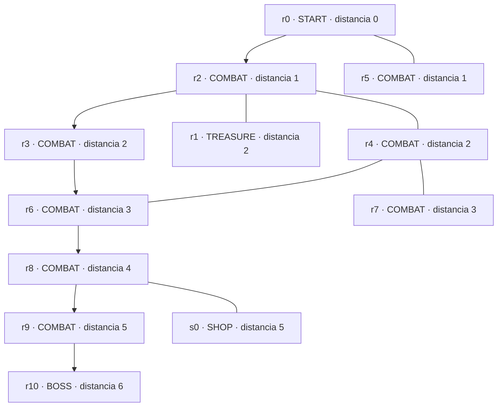

# 06 — Mapa maestro de campaña · muestra verificable

**Estado:** primera reconstrucción documental de una semilla real del generador.  
**No es una sustitución del generador ni un mapa nuevo implementado.**  
**Fuente de datos:** `ART_EVIDENCE/tanda_01/validation_run2_roomcapture.json`, build de prueba del 2026-11-03.  
**Semilla seleccionada:** `17677515`.  
**Formato:** 12 nodos, 1 planta, grafo no dirigido.

## 1. Lo que existe realmente

La evidencia de runtime contiene dos grafos de 12 nodos con semillas distintas. En ambos:
- 12 nodos.
- 1 nodo inicial (`start`).
- 8 nodos de combate (`combat`).
- 1 nodo de tesoro (`treasure`).
- 1 tienda (`shop`).
- 1 jefe (`boss`).
- 24 enlaces dirigidos registrados, equivalentes a 12 conexiones bidireccionales.
- El jefe está a distancia de grafo 6 en estas dos muestras.

La topología cambia con la semilla. Por tanto, el dibujo siguiente representa **una semilla concreta**, no una topología fija del juego.

La evidencia antigua de Fase 0.3 también registra una ejecución con `bossDistance:5`; no se debe fijar 6 como constante global. El valor depende de la generación.

## 2. Grafo de la semilla 17677515

**Ruta principal marcada por el generador:**  
`r0 → r2 → r3 → r6 → r8 → r9 → r10`

**Ramas opcionales presentes:**
- `r1`: tesoro, conectado a `r2`.
- `r4 → r7`: rama de combate; `r4` también conecta con `r2` y `r6`, creando un ciclo.
- `r5`: combate conectado al inicio `r0`.
- `s0`: tienda conectada a `r8`.

La columna `main` del generador marca la ruta principal. No inferir que una rama sea obligatoria por el orden de sus IDs.

## 3. Ficha exacta de nodos

| ID | Tipo real | Coordenada lógica (x,y) | Distancia | Ruta principal | Conexiones |
|---|---|---:|---:|---|---|
| r0 | start | (0, 0) | 0 | Sí | r2, r5 |
| r1 | treasure | (1, -1) | 2 | No | r2 |
| r2 | combat | (0, -1) | 1 | Sí | r0, r3, r1, r4 |
| r3 | combat | (0, -2) | 2 | Sí | r2, r6 |
| r4 | combat | (-1, -1) | 2 | No | r6, r2, r7 |
| r5 | combat | (0, 1) | 1 | No | r0 |
| r6 | combat | (-1, -2) | 3 | Sí | r3, r8, r4 |
| r7 | combat | (-2, -1) | 3 | No | r4 |
| r8 | combat | (-1, -3) | 4 | Sí | r6, r9, s0 |
| r9 | combat | (-1, -4) | 5 | Sí | r8, r10 |
| r10 | boss | (0, -4) | 6 | Sí | r9 |
| s0 | shop | (-2, -3) | 5 | No | r8 |

Las coordenadas son posiciones lógicas de nodos, no dimensiones de salas ni coordenadas de mundo.

## 4. Lectura de diseño propuesta (no implementada)

El grafo ya proporciona una estructura útil: una ruta principal legible, un ciclo de combate lateral, un desvío temprano, una sala de tesoro y una tienda antes del tramo final.

Propuesta de intención para esta semilla:

| Nodo | Intención recomendada | Condición de diseño |
|---|---|---|
| r0 | Entrada segura / presentación | Introducir controles y objetivo; no lanzar una emboscada inmediata |
| r2 | Primer combate | Enseñar una amenaza común y dejar visible el desvío al tesoro y al ciclo |
| r1 | Recompensa opcional | Recompensa visible antes de entrar; acceso sin daño inevitable |
| r3 | Escalada principal | Combinar un rol ya presentado con geometría distinta |
| r4 | Desvío de combate | Riesgo extra y acceso al ciclo; no repetir exactamente r2 |
| r7 | Cierre de rama | Desafío opcional breve; recompensa/ventaja debe justificar el desvío |
| r5 | Rama cercana al inicio | Ruta de combate alternativa; debe ser alcanzable y tener valor claro |
| r6 | Cruce de rutas | Reunir las ramas sin bloquear al jugador ni generar spawn encima |
| r8 | Preparación avanzada | Presentar la tienda como oportunidad; evitar que sea una parada obligatoria |
| s0 | Servicio | Compra/recuperación con inventario y precios actuales, no inventados |
| r9 | Último combate previo al jefe | Preparar lectura del patrón de jefe y comprobar recursos |
| r10 | Jefe | Arena con espacio para patrones, telegráficos y rutas de escape |

Esta tabla es una propuesta de dirección de encuentros, no la configuración actual de spawns ni de recompensas.

## 5. Reglas espaciales para las salas

La geometría de cada sala debe responder al encuentro asignado:

- **start:** entrada y salida visibles, zona de control inicial, sin decoración sólida que encierre al jugador.
- **combat:** centro de maniobra y al menos dos rutas de desplazamiento cuando la sala sea abierta.
- **treasure:** lectura clara de recompensa y coste de acceso; el contenido no debe confundirse con un pickup común.
- **shop:** espacio de interacción sin enemigos activos, si el comportamiento actual permite pausa/seguridad; confirmar antes de cambiar la lógica.
- **boss:** perímetro continuo, sin obstáculos decorativos en zonas de esquiva y espacio suficiente para todos los patrones reales del jefe.

No se fijan dimensiones hasta extraer `roomRect`, colisiones, puertas, hitboxes, alcance de armas y velocidades de movimiento de la build actual.

## 6. Contrato con la FASE 08

- Mantener IDs y conexiones del grafo.
- No redimensionar una sala sin validar puertas y conectividad.
- El zoom dinámico no puede ocultar la salida ni cortar telegráficos.
- Las distancias de combate deben medirse en mundo; no deducirse solo de píxeles de pantalla.
- Las coordenadas lógicas del grafo no se deben reutilizar como coordenadas del mundo.
- La cámara y la simulación siguen separadas.

## 7. Referencias visuales existentes

El repositorio contiene las siguientes imágenes de referencia por nombre:
- `assets/references/REF_07_mapa_hub_refugio.png`
- `assets/references/REF_08_mapa_circulo_01_lujuria.png`
- `assets/references/REF_09_mapa_circulo_02_gula.png`
- `assets/references/REF_10_mapa_circulo_03_avaricia.png`
- `assets/references/REF_11_mapa_circulo_04_ira.png`
- `assets/references/REF_12_mapa_circulo_05_herejia.png`
- `assets/references/REF_13_mapa_circulo_06_violencia.png`
- `assets/references/REF_14_mapa_circulo_07_fraude_magenta.png`
- `assets/references/REF_15_mapa_circulo_08_fraude_cian.png`
- `assets/references/REF_16_mapa_circulo_09_traicion.png`

Se han localizado por inventario, pero esta reconstrucción no afirma haber validado visualmente su contenido. Sus etiquetas históricas tampoco deben imponerse sobre la biblia narrativa vigente sin revisión.

## 8. Verificaciones realizadas sobre el grafo

Sobre las dos muestras incluidas en el JSON de evidencia:
- 12 nodos por grafo.
- Todos los destinos de enlaces existen.
- Todos los enlaces tienen reciprocidad.
- 1 nodo boss y 1 start por muestra.
- 8 nodos combat por muestra.
- 1 treasure y 1 shop por muestra.

**Limitación:** son dos grafos capturados, no una prueba exhaustiva de miles de semillas ni una auditoría del generador completo.

## 9. Siguiente extracción técnica

1. Obtener una captura de cada tipo de sala y asociarla a su ID.
2. Extraer `roomRect`, forma, puertas, colisiones y props por sala.
3. Obtener el grafo y auditoría de varias semillas, incluyendo casos de distancia de jefe 5.
4. Medir los spawns y las rutas transitables en mundo.
5. Asociar los encuentros y recompensas reales a los nodos.
6. Diseñar las variantes espaciales solo después de comparar las salas actuales.
