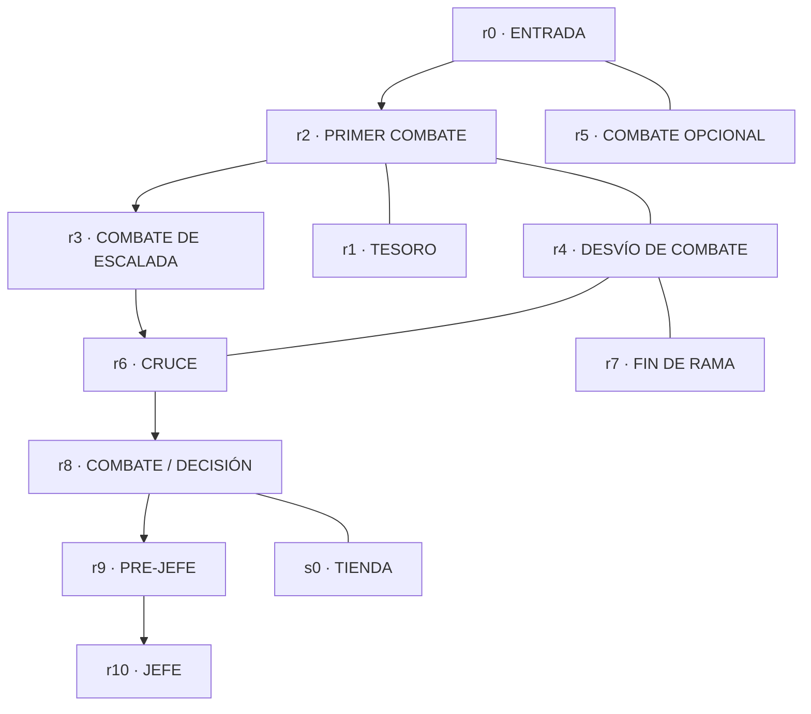

# 07 — Plan espacial de las 12 salas · v1

**Estado:** propuesta de diseño sobre una semilla real; no implementada.  
**Base topológica:** semilla `17677515`, capturada el 2026-11-03.  
**Dependencia:** FASE 08 (escala intermedia y cámara dinámica) permanece bajo trabajo de Arena.  
**Alcance:** intención espacial, ritmo, navegación y encuentro conceptual. No cambia IDs, conexiones, spawns, recompensas ni dimensiones del motor.

## 1. Principios de diseño

1. La topología real manda: conservar los 12 nodos y sus enlaces.
2. La sala debe leerse por su silueta y función antes de añadir decoración.
3. Cada sala tiene una función primaria y como máximo una secundaria.
4. Los desvíos deben comunicar riesgo/recompensa antes de entrar.
5. Las rutas de escape deben seguir siendo transitables con el jugador, enemigos y proyectiles reales.
6. Las geometrías sugeridas son objetivos de composición; su disponibilidad exacta en el catálogo y sus límites deben confirmarse en código antes de implementación.
7. No fijar medidas, número de enemigos, tiempos, daño ni recompensas hasta extraer valores activos.
8. No introducir saltos, gravedad, navegación multinivel ni nuevas reglas del Director.

## 2. Topología de referencia

Ruta principal marcada por el generador: `r0 → r2 → r3 → r6 → r8 → r9 → r10`.

No se debe asumir que la ruta principal es la única forma de recorrer el mapa. La ruta `r2 → r4 → r6` forma un ciclo; `r1`, `r5`, `r7` y `s0` son ramas de una sola conexión en esta muestra.

## 3. Fichas espaciales por nodo

Las intenciones, geometrías y encuentros de esta tabla son propuestas. Los tipos de nodo y conexiones sí proceden de la captura.

| Nodo | Tipo real | Intención v1 | Geometría objetivo | Encuentro / función |
|---|---|---|---|---|
| r0 | start | Umbral seguro | Vestíbulo ancho, contorno simple y salidas legibles | Orientación, lectura del objetivo y comprobación de controles; sin emboscada inicial |
| r1 | treasure | Cámara de recompensa opcional | Cámara compacta con foco visual central y perímetro despejado | Recompensa claramente identificable; el coste de acceso se comunica antes de entrar |
| r2 | combat | Primer examen de combate | Octógono o sala abierta de silueta limpia | Presentar una amenaza primaria conocida; enseñar movimiento y prioridad sin apilar roles |
| r3 | combat | Escalada de la ruta principal | Sala longitudinal o nave con dos rutas laterales | Reutilizar una familia ya presentada con distinta aproximación espacial |
| r4 | combat | Desvío táctico y conexión de ciclo | Planta en L o sala con dos alas conectadas | Riesgo opcional; permitir flanqueo sin encerrar al jugador en un pasillo |
| r5 | combat | Desafío opcional temprano | Arena compacta con perímetro continuo | Encuentro breve y diferenciado de r2; su valor debe justificar el desvío desde r0 |
| r6 | combat | Cruce de rutas | Sala amplia de cuatro direcciones, con centro despejado | Reunir ruta principal y ciclo; no convertir el centro en cuello de botella |
| r7 | combat | Final de rama opcional | Cámara pequeña de salida única, pero con zona de maniobra | Prueba opcional; recompensa o ventaja explícita pendiente de economía/progresión real |
| r8 | combat | Decisión antes del tramo final | Anillo abierto o sala de dos sectores, con salidas visibles | Combate legible y acceso reconocible a tienda; no hacer obligatoria la compra |
| s0 | shop | Servicio y preparación | Sala de interacción protegida y circulación simple | Compra/gestión según sistema existente; seguridad y pausa se deben verificar antes de asumirlas |
| r9 | combat | Última comprobación antes del jefe | Sala de preparación abierta, con poca decoración sólida | Encuentro que prueba recursos y movilidad sin copiar el patrón del jefe |
| r10 | boss | Arena de jefe | Octógono/círculo amplio con perímetro limpio y cobertura solo si el patrón la requiere | Espacio para patrones reales, adds, telegráficos y rutas de escape |

### Reglas específicas de los desvíos

- **r1 — tesoro:** el jugador debe poder reconocer que es una sala de recompensa. No usar un pickup común como único indicador.
- **r5 — rama del inicio:** al ser un extremo conectado solo a r0, debe tener una identidad propia. No debe parecer un camino obligatorio ni una sala vacía.
- **r4 → r7:** el ciclo ofrece una decisión de riesgo. r7 necesita un motivo de visita claro; no añadir un élite por defecto sin verificar el presupuesto de amenaza.
- **s0 — tienda:** está conectada a r8. No asumir que el motor congela oleadas, desactiva enemigos o pausa el reloj dentro de la tienda; comprobarlo en runtime.

## 4. Ritmo de la semilla

| Tramo | Función de ritmo | Principio |
|---|---|---|
| r0 → r2 | Presentación | Introducir una sola lectura nueva |
| r2 → r3 | Aprendizaje | Repetir la amenaza con distinta geometría |
| r2 → r1 | Recompensa | Desvío corto y comprensible |
| r2 → r4 → r6 | Riesgo alternativo | Ciclo con diferencia espacial real |
| r4 → r7 | Compromiso opcional | La rama debe justificar su coste |
| r0 → r5 | Desafío lateral | Ofrecer una elección temprana sin bloquear progreso |
| r6 → r8 | Reagrupación | Recuperar lectura de ruta y preparar recursos |
| r8 → s0 | Servicio | Decisión económica voluntaria |
| r8 → r9 | Preparación | Reducir ruido visual antes del jefe |
| r9 → r10 | Clímax | Presentar arena y jefe sin emboscada injusta |

Esta secuencia no fija duración ni cantidad de oleadas. Los encuentros se asignarán después de extraer las reglas actuales de spawn, caps, estadísticas y progresión.

## 5. Contrato de composición por geometría

### Entrada y cámaras de recompensa
- Mantener el punto de entrada y la salida fuera de obstáculos sólidos.
- Evitar props altos en el eje visual del jugador.
- La recompensa y su condición deben ser reconocibles desde la entrada.
- No colocar spawn de enemigos sobre el punto de aparición.

### Salas abiertas y cruces
- Reservar una zona central útil para maniobra.
- Crear rutas periféricas alternativas sin formar callejones sin salida accidentales.
- Las columnas/props no deben cortar todos los ángulos de tiro.
- En cruces de tres o más puertas, cada salida debe distinguirse visualmente.

### Salas longitudinales y plantas en L
- Evitar que un enemigo de contacto pueda bloquear toda la anchura.
- Permitir esquiva lateral en el tramo más estrecho.
- No colocar tiradores detrás de una esquina sin línea de respuesta.
- Mantener la salida visible o señalizada desde el área de combate.

### Arena de jefe
- Medir el área de evasión contra los patrones B4 reales: `fan`, `ring`, `spiral`, `burst`, `summon`, `sweep` y zonas `fire`/`elec`.
- Validar cada jefe contra sus patrones configurados, no contra un patrón genérico.
- No usar cobertura que invalide patrones ni obstáculos que oculten telegráficos.
- No compensar una arena pequeña con zoom extremo.
- No asumir que todos los jefes usan todos los patrones.

## 6. Matriz de encuentros: contrato, no valores

Las familias visuales registradas en R02 son `security`, `dancer`, `fanatic`, `chef`, `drone` y `elite`. La relación entre familia visual y tipo interno no siempre es uno a uno. Mantener IDs internos y extraer los comportamientos efectivos antes de asignar cantidades.

| Nodo | Rol que conviene enseñar/probar | Composición propuesta |
|---|---|---|
| r2 | Perseguidor o amenaza común | Una amenaza primaria; no añadir apoyo hasta validar lectura |
| r3 | Sprinter | Amenaza conocida con aviso y espacio lateral |
| r4 | Tirador + movimiento | Probar ruptura de línea de tiro; evitar bloqueo por geometría |
| r5 | Tanque o guardián | Desafío opcional con espacio para rodear; tipo exacto pendiente |
| r6 | Combinación de dos roles conocidos | Sin ataques de área simultáneos que cierren todas las rutas |
| r7 | Variante élite o prueba de presión | Solo si estadísticas/caps permiten contrajuego; no es asignación aprobada |
| r8 | Composición mixta moderada | Reforzar priorización sin interferir con acceso a tienda |
| r9 | Preparación de jefe | Probar movilidad y lectura, no revelar un patrón nuevo sin aviso |
| r10 | Jefe de la progresión real | Usar perfil B4 correspondiente y su ciclo natural |

Los términos de rol son intención de diseño. No equivalen a clases nuevas ni autorizan cambios de IA.

## 7. Dependencias técnicas pendientes

Antes de traducir esta propuesta a datos del juego, extraer y registrar:

1. `roomRect` y dimensiones reales de cada sala.
2. Forma efectiva y transformaciones de `DMO_LAYOUT`.
3. Puertas, posiciones, anchuras y reglas de bloqueo.
4. Colisiones sólidas y obstáculos decorativos.
5. Puntos y reglas de spawn por tipo de sala.
6. Tipos internos, HP, daño, velocidad, cadencia y caps activos.
7. Asociación real entre nodo, encuentro, oleada y recompensa.
8. Comportamiento de la tienda y transición de sala.
9. Distancias de jugador, proyectiles y patrones de jefe.
10. Capturas runtime a 1280×720, 1600×900 y 1920×1080.

## 8. Pruebas de aceptación para cada sala

- Se puede entrar, recorrer y salir sin atasco.
- No existen spawns dentro de sólidos ni encima del jugador.
- La sala conserva al menos una ruta de escape razonable durante el encuentro.
- Las puertas no quedan ocultas por props, efectos o HUD.
- Los ataques y telegráficos son visibles a escala real.
- Las armas de corto, medio y largo alcance conservan utilidad.
- No hay posiciones desde las que un enemigo pueda atacar sin posibilidad de respuesta.
- La función de la sala se reconoce sin depender solo del color.
- El minimapa refleja las salidas y la posición real.
- La sala se prueba con cámara mínima y máxima de FASE 08, sin modificar el trabajo de Arena.

## 9. Orden de prototipado recomendado

1. **r2:** primer combate; valida legibilidad básica.
2. **r6:** cruce; valida puertas y navegación multidireccional.
3. **r10:** arena de jefe; valida telegráficos y evasión.
4. **r4:** planta en L; valida línea de tiro y flanqueo.
5. **r1/s0:** recompensa y tienda; valida interacción y estados seguros.
6. Completar las restantes solo después de aprobar las cinco anteriores.

El prototipo debe usar las dimensiones y datos extraídos del motor. No crear una geometría paralela que después no pueda integrarse.

## 10. Estado

- Topología y tipos de nodo: **verificados para una semilla**.
- Intenciones y geometrías: **propuesta v1**.
- Spawns, encuentros y recompensas: **pendientes de extracción**.
- Dimensiones, colisiones y puertas: **pendientes de extracción**.
- Runtime, capturas y navegación: **no probados en esta tarea**.
- Implementación en motor: **no iniciada**.
