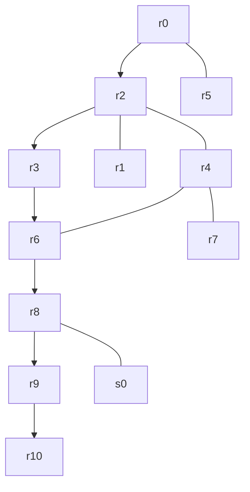
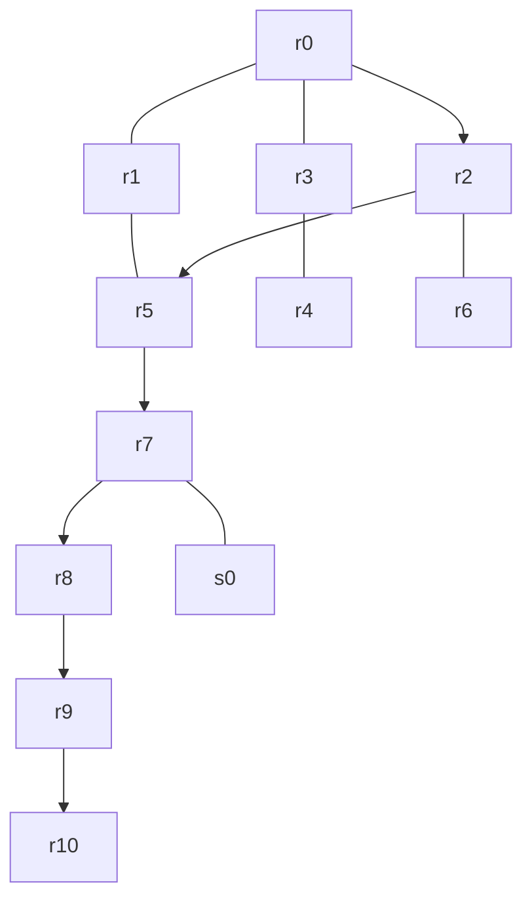

# 08 — Variabilidad topológica y diseño adaptable de salas

**Estado:** auditoría documental de dos semillas reales.  
**Fuentes:** `ART_EVIDENCE/tanda_01/validation_run2_roomcapture.json`, `FASE_0_3_EVIDENCE/log_combat_rooms_resize.json`, `src/dd_world_renderer.js`.  
**Alcance:** diseño y contratos de integración; no modifica generación, geometría ni motor.

## 1. Hallazgo principal

La planta de 12 nodos no tiene una topología fija. Dos semillas de una captura real conservan los mismos tipos y cantidades de nodos, pero cambian conexiones, coordenadas, posición de tienda/tesoro y ruta principal.

Por tanto, el diseño de las salas no puede asignarse por ID fijo (`r5 siempre es sala opcional`, por ejemplo). Debe asignarse por el tipo del nodo, su posición relativa en el recorrido, sus conexiones y su papel en la ruta principal.

## 2. Dos muestras reales

### Semilla A — 17677515

- Ruta principal: `r0 → r2 → r3 → r6 → r8 → r9 → r10`.
- Tesoro: `r1`, conectado a `r2`.
- Tienda: `s0`, conectada a `r8`.
- Rama inicial: `r0 → r5`.
- Ciclo lateral: `r2 → r4 → r6`, con `r4 → r7` como extremo de rama.
- Salidas de `r0`: dos.

### Semilla B — 502304869

- Ruta principal: `r0 → r2 → r5 → r7 → r8 → r9 → r10`.
- Tesoro: `r6`, conectado a `r2`.
- Tienda: `s0`, conectada a `r7`.
- Rama superior: `r0 → r3 → r4`.
- Rama inferior: `r0 → r1 → r5`.
- Salidas de `r0`: tres.

### Constantes observadas en ambas muestras

| Propiedad | Semilla A | Semilla B |
|---|---:|---:|
| Nodos totales | 12 | 12 |
| Start | 1 | 1 |
| Combat | 8 | 8 |
| Treasure | 1 | 1 |
| Shop | 1 | 1 |
| Boss | 1 | 1 |
| Distancia de grafo al jefe | 6 | 6 |
| Enlaces dirigidos | 24 | 24 |
| Enlaces no dirigidos | 12 | 12 |

Una ejecución histórica de Fase 0.3 registró `bossDistance:5`. No se debe convertir la distancia 6 en regla universal: la evidencia disponible no cubre todas las semillas ni versiones.

## 3. Comparación visual de topología

### Semilla A

### Semilla B

Los diagramas representan enlaces y ruta principal; no coordenadas de mundo ni tamaño de salas.

## 4. Consecuencia para el diseño de niveles

Las fichas de `07_PLAN_ESPACIAL_12_SALAS_V1.md` son válidas como lectura de la semilla A, pero no deben convertirse en reglas por ID.

Ejemplos de la variabilidad:
- `r5` es un extremo de combate conectado al inicio en A, pero pertenece a la ruta principal en B.
- `r1` es tesoro en A y combate en B.
- `r6` es combate principal en A y tesoro opcional en B.
- La tienda `s0` cambia de conexión: `r8` en A y `r7` en B.
- El nodo de inicio tiene dos salidas en A y tres en B.

**Regla de diseño:** el rol se determina por `kind`, `main`, `distance`, grado del nodo (número de conexiones), vecinos y dirección de entrada/salida; nunca por el ID aislado.

## 5. Arquetipos funcionales adaptables

| Arquetipo | Condición de selección | Función |
|---|---|---|
| Umbral | `kind=start` | Orientación, salida legible y espacio de llegada |
| Combate de ruta | `kind=combat` y `main=true` | Progresión principal; variar geometría y presión |
| Combate lateral | `kind=combat` y `main=false` | Riesgo/recompensa, entrenamiento o atajo |
| Recompensa | `kind=treasure` | Recompensa legible y acceso comprensible |
| Servicio | `kind=shop` o flag `shop=true` | Interacción económica y preparación |
| Clímax | `kind=boss` | Arena adaptada al perfil real del jefe |
| Cruce | Nodo con grado ≥ 3 | Orientación, varias puertas y navegación |
| Extremo de rama | Nodo con grado 1 que no sea start/boss | Desafío o recompensa que justifique el desvío |
| Conector | Nodo de ruta principal con grado 2 | Transición de ritmo; evitar que todas las salas sean iguales |

Estos arquetipos son etiquetas de diseño derivadas del grafo; no implican que el motor tenga estos tipos implementados.

## 6. Reglas de composición derivadas

1. La sala start debe soportar dinámicamente el número de puertas generado; no diseñar una única salida fija.
2. Los nodos de cruce necesitan lectura inequívoca de cada salida y rutas transitables entre ellas.
3. La tienda debe ser funcional en cualquier posición válida de la ruta; no depender de que esté después de una sala concreta.
4. El tesoro debe conservar su legibilidad aunque cambie su posición en el grafo.
5. Los combates de ruta principal necesitan escalada de dificultad por etapa, no por ID.
6. Los combates laterales deben aportar una función propia y no bloquear el avance principal.
7. El jefe se asigna por `kind=boss`; su arena depende del jefe seleccionado y sus patrones reales.
8. Las dimensiones y puertas deben derivarse de la topología actual, no del dibujo de una semilla de referencia.

## 7. Lo que confirma el renderer y lo que no

`src/dd_world_renderer.js` contiene `buildHighResRoomCache(ctx, worldW, worldH, roomRect, circleIdx, roomSeed, clipRoomFn)`.

Confirma:
- El renderer recibe un `roomRect` ya calculado.
- Recibe un `clipRoomFn` opcional para recortar la silueta real de la sala.
- Si no recibe `clipRoomFn`, dibuja un rectángulo.
- Renderiza suelo, fachada norte, pilares y borde de la sala.
- La fachada usa una altura visual fija de 132 unidades en ese renderer y módulos de 128 unidades.

No confirma:
- Quién calcula `roomRect`.
- Qué función genera la silueta `clipRoomFn`.
- Dimensiones de salas de campaña.
- Posiciones de puertas, colisiones o spawns.
- Que octógonos, anillos, catedrales y salas en L estén activos en cada semilla.

El comentario del renderer enumera esas formas como geometrías que el callback puede soportar, pero no es prueba de que cada forma esté conectada al generador de campaña.

## 8. Evidencia de navegación y límites

`FASE_0_3_EVIDENCE/log_combat_rooms_resize.json` registra una prueba de navegación de tres transiciones de sala y un spawn confirmado. También registra un viewport de 900×700 y un `rectW` de 900 en el bloque de resize.

No se puede inferir de ese dato que todas las salas midan 900 unidades: `rectW` pertenece al contexto de esa prueba de resize y no es un inventario de dimensiones por nodo.

La evidencia de room capture registra capturas de campaña de aproximadamente 1.28 MB y 2.37 MB en dos builds, pero no incluye en los datos extraídos aquí un catálogo de `roomRect` por habitación.

## 9. Próxima extracción necesaria

Para cerrar la auditoría de geometría hay que instrumentar o localizar en el HTML activo el punto que:
1. Calcula `roomRect`.
2. Construye `clipRoomFn`.
3. Coloca y abre/cierra puertas según los enlaces del nodo.
4. Genera obstáculos y colisiones.
5. Calcula posiciones seguras de spawn.
6. Asocia encuentro y recompensa al nodo.

No se deben añadir nuevas formas ni alterar dimensiones hasta encontrar esas funciones y capturar sus datos en runtime.

## 10. Estado

- Dos grafos reales comparados: **verificado documentalmente**.
- Tipos/cantidades de nodos: **iguales en las dos muestras**.
- Topología fija por ID: **refutada por las muestras**.
- Renderer consume rectángulo y callback de silueta: **verificado en código**.
- Dimensiones y colisiones por sala: **pendientes**.
- Generador completo y exhaustividad de semillas: **no auditados**.
- Implementación de geometrías nuevas: **no iniciada**.
