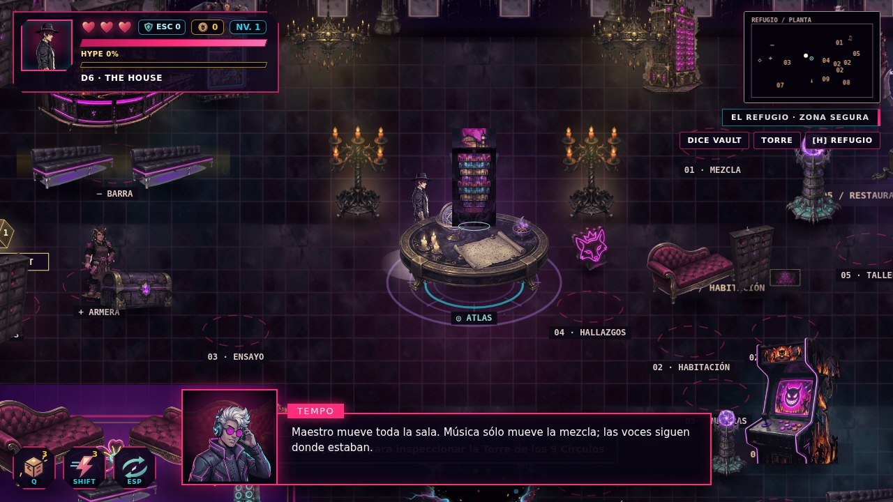

# Refugio persistente · integración y validación

**Recorrido jugable:** nueva partida → intro y descenso existentes → Refugio → explorar y preparar equipo → grieta → incursión nativa → resultados → **Volver al Refugio**. Reintentar y Menú principal siguen disponibles. Continuar abre el mismo Refugio con los avances del navegador. Sin portales nuevos: las nueve zonas son sectores de una misma planta, no nueve mapas ni nueve pistas de la historia.

## Reconocimiento y decisiones de integración

| Sistema existente | Integración | Lo que no se ha duplicado |
|---|---|---|
| `DD_HUB.enter`, `update`, `render`, `exitToRun` | Mantener bounds, cámara, teclado, mando, colisiones, orden por profundidad y grieta. Extender las seis estaciones a dieciséis. | Ni otro mundo, ni un generador de salas, ni otro bucle de juego. |
| `DD_UI.readProgress()` | Galería y conversaciones leen récords, historial, victorias, mejoras y `first_boss`. | No se reescriben logros, bajas, fichas ni registros de incursión. El historial puede estar vacío. |
| Tienda nativa `#shop .shop-row` | El inspector de habitación presenta ofertas reales y delega en sus botones habilitados. | Un solo precio, cobro, guardado y efecto. No se escriben directamente saldos con el juego en marcha. |
| `DD_DICE`, Dice Vault, `DD_DICE_GEOMETRY` | Selección, estadísticas y variantes existentes; ensayo local de giro y lectura de cara. | Sin equipar armas históricas, lanzar proyectiles ni consumir tiradas. No es un simulador de daño. |
| `DD_APPEARANCE` | Consultar y alternar atuendos disponibles desde la habitación. | Se conservan las reglas vigentes, incluido el modo de prueba de atuendos. |
| `DD_UI.openMap`, Mesa Astral, dossiers, biblia §5.4 | Se conserva el atlas; estantería independiente para descubrimientos locales. | Ni la proyección de las nueve pistas ni los diez registros operativos cambian. Ningún NPC nuevo. |
| `DD_BOOT.audio`, mezcla del motor | Reproductor usa la pista existente; la cabina opera los controles nativos Maestro/Música. | Sin segundo reproductor, pistas inventadas ni otro guardado de volumen. |
| `DD_UI.STORAGE`, ficha `dd_save_v1` | Añadir sólo `dd_refuge_record_v1` al grupo permanente. | No migrar ni vaciar una partida antigua. No se promete reanudar incursiones a medias. |

## Mapa de zonas y conexiones físicas

La entrada al salón está en **(910,700)**. Desde el pasillo central se camina hacia cada sector, rodeando el mobiliario. Las coordenadas son unidades del mundo, no píxeles de pantalla. `DD_HUB.layout()` expone una copia de la planta para comprobaciones, sin operaciones de viaje.

| Zona | Orientación / puntos de interacción | Qué puede hacer el jugador |
|---|---|---|
| 01 Salón | Centro y escenario NE · Tempo (1400,330), mezcla (1240,387) | Conversar y ajustar por separado Maestro y Música. |
| 02 Habitación | E · sofá (1210,665), kit (1245,740), vitrina (1342,651) | Examinar, cambiar de atuendo, comprar mejoras nativas y exhibir recuerdos. |
| 03 Arsenal | O · Dice Vault (240,615), marca de ensayo (570,650) | Inspeccionar y equipar; probar y detener un giro sin consecuencias sobre el combate. |
| 04 Archivo | Centro · Mesa Astral (905,585), hallazgos (1068,616) | Leer el atlas y dossiers reales; consultar procedencia o pista de un hallazgo pendiente. |
| 05 Taller | E del escenario · banco (1460,535) | Comprobar requisito o completar la siguiente restauración. |
| 06 Residentes | Barra NO (400,415), Armera O (378,585) | Conversación individual con retrato, memoria y temas opcionales. Tempo conserva su cabina. |
| 07 Descanso | SO · sillón (480,943) | Examinar el surco y controlar el reproductor restaurado. |
| 08 Galería | SE · expositor (1330,908) | Consultar récord, victorias, bajas y puntuación de cada registro; mostrar hitos en la vitrina restaurada. |
| 09 Acceso | S · preparación (1065,860), grieta (910,875) | Revisar atuendo y dado sin salir; iniciar sólo desde la interacción de descenso existente o su atajo previo. |

## Evolución verificable

| Trabajo / coste | Requisito | Cambio en el mundo |
|---|---|---|
| Circuito · 0 fichas | Hablar con la Armera, después accionar el banco | Luz cálida junto a los candelabros. |
| Reproductor · 0 fichas | Circuito y surco descubierto en el sillón | Aparece un subwoofer, se activa el control del sillón y Tempo se acerca a su monitor. |
| Vitrina · 0 fichas | Reproductor, sello del archivo y al menos una entrada en el historial real | Aparece el pedestal de la galería y se pueden consultar los hitos conseguidos. |
| Kit permanente · precio nativo en fichas | Oferta disponible y saldo suficiente | El motor actualiza el kit de futuras incursiones. |

Las restauraciones son trabajos de exploración y no compras encubiertas. Sólo el kit cobra fichas. Los tres hallazgos tienen ID estable, lugar, descripción y requisito de inspección. Se pueden exhibir en la habitación; reunirlos y examinar el archivo revela el sello. Ninguno concede daño, altera la economía ni sustituye una reliquia de combate.

Cada interlocutor progresa de presentación a conocido y habitual; al ganar confianza se abren dos temas elegibles por personaje. Las intervenciones especiales tienen prioridad determinista y se recuerdan individualmente (resultado oficial, primer jefe documentado, hallazgos y reparación). Los temas elegidos quedan marcados como leídos. Los encuentros importantes no dependen del generador aleatorio ni de que un NPC vuelva a aparecer.

## Persistencia y compatibilidad

La nueva clave guarda únicamente estado del Refugio: conversaciones, temas, último desenlace oficial conocido, hallazgos, objeto expuesto, sello, restauraciones y pausa del reproductor. Las zonas son accesibles a pie desde el principio; lo que se desbloquea son sus funciones. Los estados de relación se derivan de contadores, no se guardan por segunda vez. Un registro incompleto se normaliza por campo; una versión futura no se sobrescribe. Guardado local del navegador, no de nube. Un almacenamiento bloqueado no impide jugar pero no garantiza persistencia.

## Archivos de esta integración

- `src/dd_refuge_record.js`: modelo versionado y reglas propias del Refugio.
- `src/dd_hub_system.js`: planta, estaciones, interacción, convivencia, ensayo, iluminación, mobiliario e inspectores.
- `src/dd_ui_system.js`, `src/dd_rebuild_ui.css`: registro de guardado, retorno de resultados, propiedad del input y presentación del inspector.
- `tools/build_active_html.py`: inclusión del módulo; `index.html` y `DEADBEAT_DISCO.html` regenerados, sin editar el motor ni su balance.
- `tools/qa/refuge_{record,restart,walkthrough}.cjs`: pruebas nuevas. `test_map_atlas.cjs` actualiza la comprobación de planta; `test_ui_results.js` incorpora el nuevo control al orden de foco esperado.

## Validación y límites

| Prueba ejecutada | Resultado |
|---|---|
| `refuge_record.cjs` | Pasa. Datos inválidos, antiguos y futuros; requisitos de tres obras, idempotencia, memoria. |
| `refuge_walkthrough.cjs` | Pasa. Nueva partida, 9 sectores y 16 estaciones por desplazamiento/colisión reales (pasos acelerados de QA, sin escribir coordenadas), tecla E y A simulada mantenida, mezcla, tema de diálogo, colección y restauración. Compra nativa: 200 → 50 fichas, siguiente incursión con **4 vidas**. Inspector a 390 y 1280 px de ancho. Sin errores de página/consola. Derrota por `DMO.playtest.hurt`, retorno jugable desde resultados, cierre de página y Continuar. Perfil desechable con saldo e historial sembrados. |
| `refuge_restart.cjs` | Pasa. Cierre completo de Chromium y reapertura del perfil temporal: obra, evento y relación sobreviven; ficha antigua intacta. |
| `test_map_atlas.cjs`, `test_cartography_tour.cjs` | Pasan. Atlas, foco y mando simulado, puertas generadas, nueve residentes y Núcleo; diez fichas a dos escalas sin movimiento. El tour usa asistencia QA para despejar encuentros. |
| `dice_engine.cjs` | Pasa. Seis dados, lanzamiento, retorno, esquiva y jefe en simulación; no aparecen balas convencionales. |
| `test_ui_results.js` | Pasa en modo completo: catálogo de seis dados, restricciones de equipo, navegación por teclado y mando simulado, HUD y pausa en cuatro resoluciones, resultados en seis, reintento y regreso al menú. |

No se ha probado un mando Xbox físico, rendimiento de consola ni la calidad subjetiva de una campaña larga. El reproductor ofrece la mezcla existente, no una biblioteca de canciones nuevas. Los estados de relación son del Refugio y no establecen parentesco con residentes de incursión ni soberanos.
