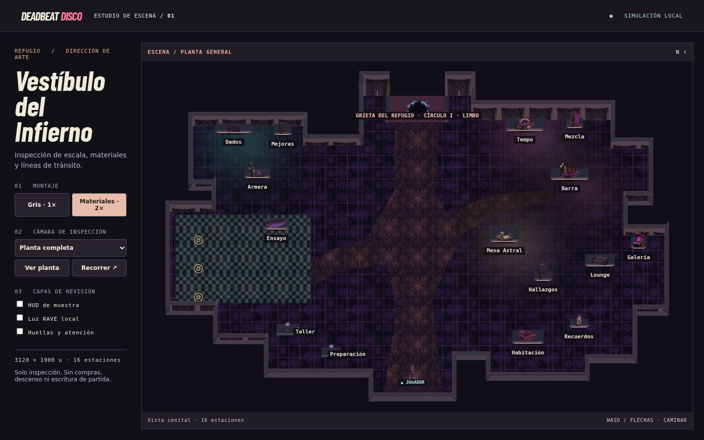

# Estudio de escena · planta orgánica 2×

Abrir `/previews/vestibulo/`. **Materiales · 2×** es el montaje inicial; **Gris · 1×** conserva el plano rectangular de referencia. No hay modo 3× activo. El encuadre de planta ajusta ambas variantes a la pantalla: usar **Recorrer** para comparar distancias con la misma velocidad y tamaño corporal.

- **Forma:** envolvente 3120 × 1900 unidades, no un rectángulo totalmente transitable. El acceso sur se estrecha, el eje se abre en un distribuidor y los ramales se desplazan hacia el ensayo oeste y la barra este. Los retranqueos alojan el arsenal y la cabina; archivo y habitación tienen profundidades diferentes. Recorrer los bordes: suelo, muros y contención local comparten el mismo polígono.
- **Alturas:** cara de la Grieta 128 u, cabina 98 u, laterales 42–62 u y bordes bajos del sur 28 u. El relieve es visual, no introduce desniveles transitables. El umbral conserva su área de proximidad; sus dos lados fijan los cortes y las jambas.
- **Piezas:** bases y límites de altura propios para mostradores, sofás, estantes y altavoz; las figuras de atención ya no triplican el tamaño corporal del jugador. Revisar desde la cámara de Tempo y la del Lounge. Las piezas frontales tienen franja al sur; los módulos laterales de Taller y Preparación usan una pieza sin respaldo, con el frente al este. Activar huellas y pasar por delante/detrás.
- **Rótulos:** texto en píxeles de pantalla independiente del zoom. En planta estrecha se usan números vinculados a las 16 opciones del selector, sin reducir la tipografía. Seleccionar una cámara recupera el nombre completo sin desplazar al personaje.

El plano alternativo está en `previews/vestibulo/organic.js`. Las posiciones de producción y los sistemas de incursión no se editan. Comprobaciones: `node tools/qa/vestibulo_organic.cjs` (continuidad del recorrido hasta 16 frentes y hueco norte) y `node tools/qa/vestibulo_preview.cjs http://localhost:8000` (Chromium, recursos, cámaras, cambio 1×/2×, HUD y luz local).

## Revisión de relieve y frentes

En **Materiales · 2×**, enfocar **Grieta del Refugio** para ver siete peldaños (84 u de desnivel) y **Tempo** para ver cuatro (48 u). Ambos se suben desde el sur. La huella de cada peldaño distingue superficie, contrahuella, nariz iluminada y pasamanos. El descanso, los pies, la sombra y la franja de atención consultan la misma cota; el acceso por el lateral alto se rechaza en el paseo local. No se desplaza el rectángulo lógico de la Grieta. Las sombras de pared se proyectan hacia el sureste con longitud proporcional a la altura.

Activar **Vectores de frente** y **Huellas y atención**. Una flecha apunta desde la cara operativa hacia su zona útil. Las vistas frontales tienen sur como referencia 0°; se compensa la inclinación de la ilustración y se recorta el margen transparente para anclar la base visible. Para 90° (oeste), el Lounge usa una vista de perfil con respaldo al este; para 270° (este), Taller y Preparación usan módulo radial y panel de mando lateral. Las dianas verticales muestran su cara hacia el interior del campo, al este. Las personas de atención heredan el frente de su mostrador. Cambiar a **Gris · 1×** retira las dos plataformas y la auditoría de frentes.

[Captura del montaje con escaleras](../../ART_EVIDENCE/VESTIBULO_PREVIEW/relieve-2x.jpg).
