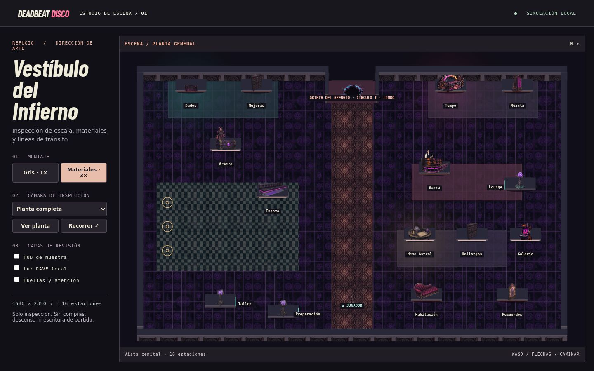

# Vestíbulo del Infierno · estudio de escena

> Archivo histórico: la simulación activa ahora es la [planta orgánica 2×](PREVISUALIZACION_2X.md).
Con el repositorio servido por HTTP, abrir `/previews/vestibulo/`. Alternativa: `python previews/vestibulo/serve.py` y abrir `http://localhost:8013/`. No sustituye el Refugio jugable ni requiere una incursión. Cerrar la pestaña revierte la inspección.

**Gris · 1×** reproduce la planta de referencia. **Materiales · 3×** mide 4680 × 2850 frente a 1560 × 950: triple distancia por eje, nueve veces la superficie. Posiciones, huellas, muebles y franjas se escalan juntos; radio, figura y velocidad física del caminante permanecen constantes. En planta ambas caben en pantalla; usar **Recorrer** para sentir la distancia. Las cámaras de estación solo cambian el encuadre, no desplazan al personaje ni activan E/A. El origen común es `src/dd_hub_layout.js`; `materials.js` asocia arte y `studio.js` controla cámara, movimiento y pintura local. Los elementos de atención lateral usan piezas sin respaldo y una cara de mostrador marcada; no se tumban sprites de pared para simular otra vista.

## Inspección sugerida

1. Desde el sur, recorrer el eje completo sin atravesar la Mesa Astral. ¿Es reconocible la Grieta antes de poder leer su nombre? Enfocar `descent` y revisar corte, jambas y texto «Círculo I · Limbo».
2. En oeste/este alternar 1× y 3× en la misma estación. Comparar ancho de mostrador con cuerpo del personaje, tamaño de cabina frente a Tempo y distancias entre paradas. Si parecen gigantes, registrar el ID antes de proponer escalar mobiliario independientemente.
3. Activar huellas. Bordear cada base y entrar por su franja; observar sombra y orden por pies. Comprobar especialmente los frentes laterales de Taller, Lounge y Preparación. La Mesa Astral no abre caminos, y las dianas no conceden impactos/recompensas en este visor.
4. Revisar áreas vacías durante el paseo y repetición de texturas desde planta. Examinar si el damero del ensayo o la alfombra central compiten con personaje y rótulos. En pantalla estrecha usar las cámaras de detalle (la planta oculta los rótulos secundarios si no caben).
5. Comparar HUD de muestra apagado/encendido y luz RAVE local con movimiento reducido. Revisar esquinas superiores, accesos inferiores y contraste de pies/umbrales. Son pruebas de composición, **no** mediciones del HUD ni del RAVE del juego real.

`node tools/qa/vestibulo_preview.cjs http://localhost:8000` comprueba en Chromium la carga de recursos, ambas escalas, selección de cámara, entrada de movimiento, HUD/luz y ausencia de motor/guardados en perfil limpio. El visor no accede a almacenamiento, audio, Director, combate ni generador. No aporta evidencia de rendimiento o legibilidad de Hangar-16.
