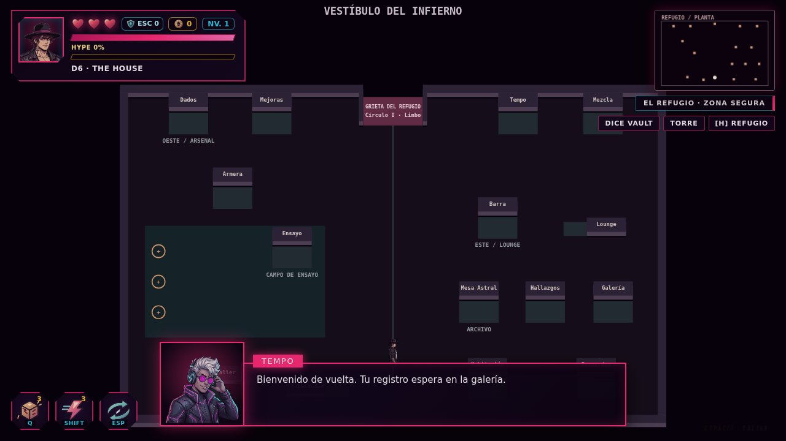

# Vestíbulo del Infierno · montaje gris integrado

**Cómo revisarlo:** entrar al Refugio desde el menú. Recorrer las franjas de suelo ante los bloques y usar E / A. Al oeste, activar *Ensayo*, apuntar con ratón o stick derecho, lanzar con clic / RT y hacer dash en movimiento con Espacio / B. Los impactos se cuentan solo en esa sesión. Salir caminando del recinto descarta el proyectil, impulsos y contador. El rectángulo magenta del norte es el único acceso peatonal al descenso; la Mesa Astral abre el mapa existente, no transporta al personaje.

| Archivo fuente | Responsabilidad |
|---|---|
| `src/dd_hub_layout.js` | Planta local compilada al mundo, spawn, sólidos, franjas, dianas y predicado transitable con radio de actor. Umbral compartido por muros, jambas y estación. |
| `src/dd_hub_greybox.js` | Render diagnóstico, profundidad por base y conversión de puntero a suelo con la misma cámara. |
| `src/dd_hub_range.js` | Sesión efímera sin acceso a almacenamiento, RNG, dado, gestor de salas o economía. El lanzamiento es de prueba, no una tirada de incursión. |
| `src/dd_hub_system.js` | Ciclo del Hub, mando/teclado, sesiones y acciones de las 16 estaciones. Conserva los servicios originales para diálogos, compra, mezcla, mapa y récord. |
| `src/dd_ui_system.js` | H entra al Refugio; ya no permite descender desde cualquier lugar de la pista. |
| `tools/build_active_html.py` | Inserta los módulos antes del controlador. `index.html` y `DEADBEAT_DISCO.html` son salidas generadas. |

**Verificación:** `node tools/qa/hub_greybox.cjs` recorre la planta y comprueba IDs, frentes, bases, eje central y límites del hueco. Se incluye en el workflow de reconstrucción. Con el juego servido en `http://localhost:8000` y Playwright/Chromium disponibles, ejecutar `node tools/qa/refuge_walkthrough.cjs http://localhost:8000`. Recorre estaciones mediante entradas, compra una mejora por la interfaz nativa y regresa al Hub después de una derrota. Prueba impactos y dash con mando simulado, y ratón/teclado en una sala nativa poblada y pausada. Compara snapshot nativo (excepto el flag de pausa), cartografía, plan generado, dado, guardado de dados y saldo hasta que se entrega el control al motor. El arranque/reanudación nativo **sí** puede cambiar estado después de esa entrega. No se guarda ni restaura una copia artificial de la incursión.

También pasaron `refuge_restart.cjs` (dos arranques de Chromium), `room_generation_live.cjs` (dos semillas) y `dice_engine.cjs` (seis dados, esquiva y contacto con jefe). Diagnóstico de solo lectura: `DD_HUB.layout()`, `DD_HUB.walkable(x,y)` y `DD_HUB.getState().practice`. No se certifican mando físico ni arte final; los bloques identifican funciones, no representan NPCs o mobiliario terminados.
