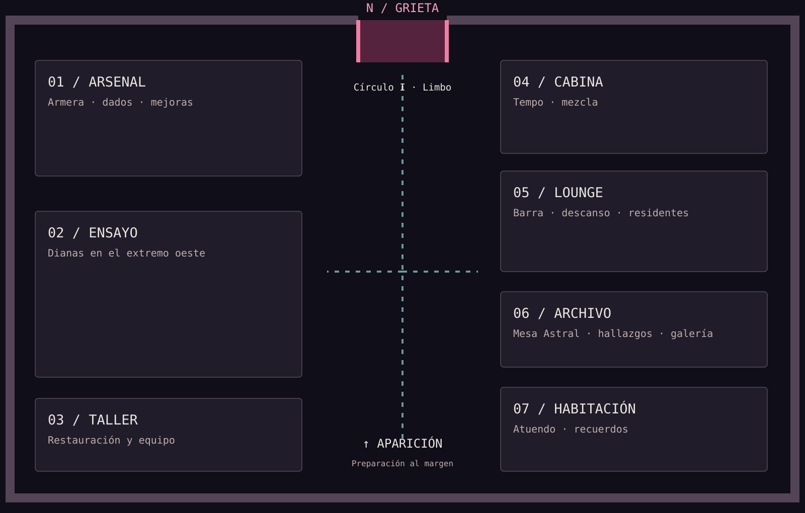

# Vestíbulo del Infierno · propuesta para revisión

**Alcance:** reorganizar el Refugio, no añadir otro destino. Este plano no cambia el juego. Las cifras son unidades del mundo propuestas; los números del plano identifican sectores físicos, no círculos, pistas narrativas ni IDs de guardado.



### Recorrido y lectura

Conservar el rectángulo actual de 1560 × 950. El plano usa coordenadas locales, con origen en la esquina NO; sumar `(130,145)` una sola vez al adaptar al mundo. Aparición en `(780,832)`, apuntado inicial `−π/2`; franja central `x=640…920` sin props sólidos. Desde el sur se ve el remate magenta de la Grieta. A media pista una línea cian corta lleva al ensayo; al este, luz ámbar sobre los frentes de atención. Usar cortes y rótulos además del color. El título es **Vestíbulo del Infierno**; la estación conserva **Grieta del Refugio · Círculo I · Limbo**.

Al NO, exposición de dados y mejoras con la Armera, dejando paso frente al mostrador. Al oeste, ensayo con entrada desde el pasillo y dianas hacia el exterior, lejos del tránsito. Al SO, taller. Al NE, cabina y altavoces contra el tramo **norte** de esa ala: sus frentes miran al sur y se pueden reutilizar sprites frontales sin tumbar su eje vertical. Lounge al este con sofás enfrentados **solo si existe la vista correspondiente**; en otro caso, bancos paralelos mirando a la pista social. Archivo y habitación en ensanchamientos del este, no en el eje de descenso. Mesa Astral de consulta, sin rutas nuevas. Preparación junto al spawn, fuera del pasillo.

### Una fuente de geometría

Separar en la futura integración: `layout` (datos locales), `compileLayout` (instancias estáticas), controlador de estaciones y render del Hub. Ninguno decide la siguiente sala. Ejemplo de contrato propuesto, no API existente:

```js
const room = {w:1560, h:950, wallThickness:24, faceHeight:46};
const gate = {id:'descent', wall:'N', center:780, width:176, depth:84};
const descentRect = g => ({x:g.center-g.width/2, y:0, w:g.width, h:g.depth});
// Rectángulo de suelo canónico, en coordenadas locales.
const threshold = descentRect(gate);
const northSpans = [[0,threshold.x], [threshold.x+threshold.w,room.w]];
```

Extruir **solo** esos dos tramos: tapa oscura, cara vertical orientada al interior y retornos laterales en los extremos del corte. Las jambas ocupan los últimos 12 px de cada tramo sólido, no la luz libre. El resto del perímetro comparte vértices en las esquinas; no solapar cuatro tapas translúcidas. No pintar primero un muro continuo en la caché. El suelo de la Grieta, su marca, el área de E/A y su depuración consumen `threshold` por referencia. El actor puede pisar el umbral; un límite al fondo evita salir del mapa sin activar E/A. Sin teletransporte por contacto. El muro sur dibuja su frente después de lo que oculte, no tapa toda la escena desde la caché.

Para las demás estaciones, especificar `{id, anchor, facing, footprint, approachDepth, art, action}`. `anchor` es el centro de la base, nunca la esquina de la imagen. Para pared, `anchor` procede de `(wall,offset,inset)` y `facing` de su normal interior: N `(0,1)`, E `(-1,0)`, S `(0,-1)`, O `(1,0)`. Para suelo, solo cuatro direcciones. Transformar la huella al suelo y derivar de su borde frontal la franja de atención accesible. **La huella bloquea; la franja no**. La marca visible de interacción, el prompt y el detector usan esa misma franja. El sprite se dibuja por base y vista cardinal; no rotar un bitmap vertical como si fuera una ficha cenital. Si no hay vista lateral, cambiar el soporte o producir la vista antes de aceptar el elemento. Diálogos de residentes derivados de su base real (también tras reparar), no de coordenadas abandonadas. Resolver coincidencias por distancia al frente y luego ID estable; E/A por flanco, un solo destinatario.

Mantener los 16 identificadores: `descent, prepare` en acceso/preparación; `armory, armorer, upgrades` en arsenal; `practice` en ensayo; `workshop` en taller; `dj, mix, bar, rest` en cabina/lounge; `map, ledger, gallery` en archivo; `bedroom, keepsake` en habitación. Mantener los despachadores actuales y los registros persistentes, aunque cambien las coordenadas. Para prop no interactivo basta base, huella, vista y arte. Derivar colisión de esa huella y radio real del actor, incluida la aproximación diagonal; no conservar en paralelo la lista anterior de círculos de mobiliario. Orden: suelo y marcas → lista por Y de los pies/borde de apoyo (desempate estable) con sombra elíptica corta antes de cada sprite → elementos altos que realmente ocluyan → HUD y subtítulos. Mesas con objetos encima forman un grupo de profundidad.

### Aislamiento e integración

- **Entrada:** mantener `DD_HUB.enter()` como único punto de entrada desde menú, cinemática o resultados (`src/dd_ui_system.js`). Activar pausa con `__DD_BRIDGE.setPaused(true)` antes del primer paso local. Inicializar posición, orientación, reloj, botones y animación **locales**; hoy `update` escribe en `DMO.playerAnim`: separar ese estado visual para no arrastrarlo a la incursión. No cargar un snapshot antiguo al salir: pisaría compras legítimas.
- **Dentro:** actualizar solo navegación, vecinos y estaciones del Hub. Reutilizar `DD_UI.openShop()`, `openMap()`, conversaciones, mezcla y kit permanente por su ruta existente. Una compra explícita puede gastar saldo permanente; caminar, apuntar o ensayar no. No llamar al tick de salas, generador, resolución de daño, RNG de la incursión, combos ni acumulador RAVE. Audio y subtítulos de Tempo por las rutas actuales. Un pulso ambiental, si se usa, es local y no activa RAVE.
- **Ensayo propuesto, no existente:** E/A sobre `practice` abre un modo local con dianas estáticas. Ratón convertido con la inversa de la cámara o stick derecho para apuntar; mismas asignaciones de lanzamiento y dash que el juego. Leer solo la configuración del dado equipado. Compartir cálculos puros de movimiento/trayectoria y tiempos cuando se puedan aislar; no ejecutar un lanzamiento sobre `DD_DICE.d` ni copiar todo el motor. Pose, carga de práctica, recuperación y proyectil viven en una sesión efímera sin referencia mutable a jugador, inventario o sala. Intersectar el segmento recorrido con dianas/contorno: señal de contacto, sin daño, premios ni tiradas persistidas. Dash respeta límites con barrido; sin i-frames de partida. Salida explícita o pérdida de modo cancela entradas, efectos y sesión; consumir la suelta pendiente antes de devolver controles. Si no se puede separar una primitiva sin alterar combate, bloquear esa parte del ensayo: la muestra actual de `practiceUntil` no es un sustituto.
- **Descenso:** solo desde el umbral y con foco de juego. Enclavar transición, vaciar ensayo y botones, mantener pausa durante la cinemática. Reutilizar `DD_HUB.exitToRun()` → `DD_CINE.playCircleDescent(0, callback)` → `__DD_BRIDGE.startRun()` una sola vez. El gestor nativo decide sala, semilla y estado inicial. No implementar continuación de una run por inferencia de récord. Ante cancelación previa al arranque, volver al Hub pausado. Tras derrota, victoria o retirada, mantener liquidación y guardado nativos antes de volver a `enter()`; el Hub no liquida ni concede nada.

### Revisión y puertas de aceptación

1. Validar plano sin arte: continuidad cardinal y diagonal, alcance de las 16 franjas desde spawn con radio de actor, ninguna bloqueada por muebles restaurados; norte sin segmento ni colisión invisibles sobre la abertura. Superponer huellas, normales y franjas al dibujo también con zoom/cámara desplazada.
2. Revisar por delante/detrás de cada pieza, pies, sombra y oclusión en las cuatro alas. Verificar que un clic o E fuera del umbral no desciende; dentro, pulsación sostenida solo inicia una transición. Comprobar menús con teclado y mando y sin movimiento residual tras cerrar.
3. Comparar campos de vida, moneda, munición si aplica, carga, RAVE, sala, enemigos, RNG y guardado antes/después de 100 ensayos sin compras. Ningún cambio atribuible al ensayo. Comparar arranques con semilla controlada con y sin ensayo. Probar compra explícita aparte: un solo débito y conservación al volver. Verificar retorno tras muerte/victoria/retirada sin duplicar resultado.
4. Reutilizar `tools/qa/refuge_walkthrough.cjs`, `refuge_restart.cjs` y las pruebas de dados; sustituir rutas hacia las coordenadas antiguas por destinos compilados, manteniendo pruebas independientes de orientación y accesibilidad. Revisar capturas y mando físico antes de aprobar. **Estas son pruebas propuestas, no resultados de esta entrega.**
