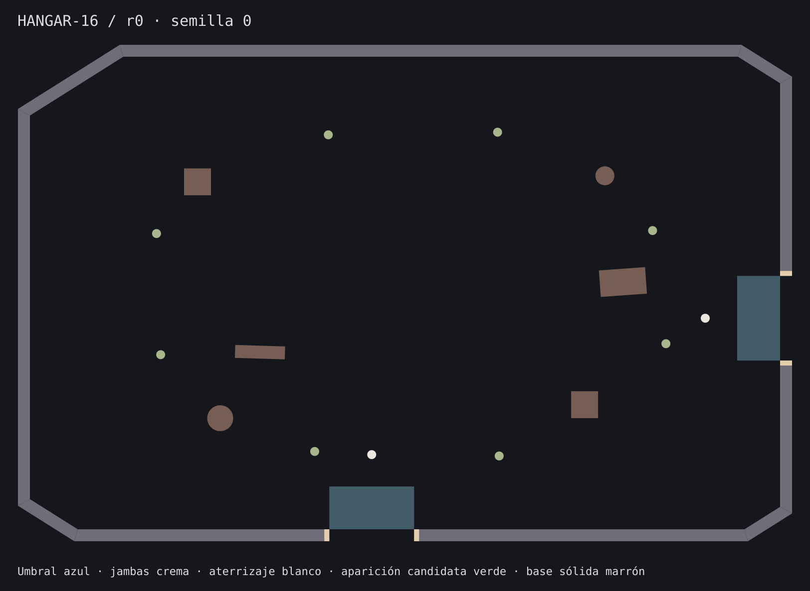

# Hangar-16 · contrato de arquitectura de combate

**Entrega para revisión, no sustitución del render de producción.** El piloto toma una sala *wide*, familia visual HANGAR-16. No cambia la primera sala de todas las partidas ni añade un nodo. La imagen es una proyección cenital de la salida del compilador en Chromium, no una captura del arte final.

## Qué se puede inspeccionar hoy

Servir el proyecto, abrir `/?roomDebug&roomSeed=0`, iniciar una incursión y ejecutar `const a = DD_ROOM_DEBUG.architecture()` en consola. `console.table(a.openings)` lista únicamente los enlaces físicos instalados, incluido el ascensor cuando exista. Se devuelve una instantánea numérica; leerla no cambia la sala. En modo normal no se expone el compilador. `src/room_generation/architecture.js` es puro; `tools/room_generation_migration.py` conecta el inspector con los objetos nativos al construir los HTML. No se serializa el contrato en el guardado.

| Salida | Fuente y uso previsto |
|---|---|
| `walls` | Aristas finales `Rs.edges`, en unidades de mundo. Cada tramo tiene línea interior `face`, normal y cuatro vértices de tapa `cap`. Las esquinas comparten la intersección de las líneas desplazadas, incluso en chaflanes. Para el alzado, proyectar la línea de base y levantarla a la altura del material: no inventar un segundo perímetro. |
| `openings` | `Ot.doors`, construidas por `xg` sobre la arista escogida por `cg`. La abscisa local del centro y un único ancho libre (170) cortan los tramos. El mismo intervalo produce el umbral y ambos bordes interiores de las jambas. Grosor exterior piloto: 24, jamba: 10. Sin puerta real no hay hueco. Un intervalo que no cabe se rechaza; no se corrige desplazando solo el dibujo. |
| `fixtures` | Instancias finales `tc`, no las propuestas de población RG2. Centro de base, orientación, `sortY`, sólido/alto/destructible/roto y círculo, rectángulo orientado o cápsula nativa. El radio de descarte rápido **no** es la huella. Nunca usar esta instantánea como colisionador después de romper o mover un objeto. |
| `spawnCandidates` | Propuestas de población llevadas al mundo. No son enemigos ni puntos garantizados: el Director conserva todas sus comprobaciones. |
| `hazardSource` | Indica que los peligros son dinámicos y pertenecen al motor. No hornear láseres ni marcas de ataque en la geometría estática. |

### Dónde integrar sin duplicar reglas

1. **Después de instalar el perímetro y las puertas definitivas**, construir solo la parte estática una vez por revisión de sala. La secuencia de entrada puede ejecutar `xg` más de una vez: no conservar referencias a puertas anteriores. Las tapas y caras sustituyen el dibujo continuo, no se superponen a él. La decoración antigua que sondea los cuatro lados con `cg` no debe crear vanos en lados sin enlace. El cierre móvil de una puerta sellada es una hoja dentro de la luz; no cambia el corte de muro. Usar `Mg` y `Ot.openT` para su estado, sin cachearlos en la malla.
2. **Interacción:** no convertir la sala en un pasillo abierto al vacío. Conservar la contención de actores y proyectiles en el polígono hasta que el gestor efectúe la transición. `Tg` selecciona la puerta próxima (137); `Sg` usa proximidad más estrecha (86), intención hacia fuera y excluye el ascensor. Sustituir sus cálculos de centro por `opening.origin`, radios por los campos del contrato y la dirección por `opening.normal`; **no** sustituir `wg`/`Mg`, enfriamiento, derrota o reglas del residente. El umbral gráfico comparte centro y marco, no tiene por qué hacer que el alcance cómodo de E sea igual al cruce automático. `vg` usa el punto de llegada interior a 150 con la corrección de posición nativa. El ascensor sigue usando `kg`.
3. **Montajes:** para un módulo de pared definir `(edge, distanciaSobreTramo, ancho)`. Admitirlo solo si su huella completa cabe en un tramo sólido sin invadir jambas. La tangente gobierna la base y la normal interior el frente. En el suelo autorar `quarterTurns` de 0 a 3 antes de crear la instancia con `mc/gc`; en cápsulas orientar también su eje. No redondear en el render una colisión ya creada a otro ángulo. Conservar orientaciones excepcionales de snapshots antiguos, marcarlas para revisión. Si falta una vista lateral del sprite, cambiar el soporte o el arte, no girar de lado un altavoz vertical.
4. **Cobertura e interacción:** en la primera integración no añadir E a mesas, sofás o pilares. Para un mostrador realmente interactivo, declarar la acción nativa, cara local y profundidad de atención. Con `c` centro del rectángulo, `n` normal del frente y `t` tangente, la franja se extiende desde `c+n*semifondo` hasta `c+n*(semifondo+alcance)` y `±semiancho*t`. Transformar una vez por pose; dibujo de marca y detector leen la misma franja. La base, no la franja, sigue pasando por `ec/nc`; conservar las pruebas nativas que distinguen cobertura alta, baja, rota y tipo de proyectil. Evitar cualquier bloqueo por un objeto puramente visual.
5. **Profundidad y peligro:** dibujar suelo/umbral primero, sombra corta centrada en la huella inmediatamente antes del cuerpo, y usar el mismo orden por pies de actores y `sortY` de props. Un proyectil visible conserva su trayectoria y altura de dibujo nativa; no resolver daño por orden de pintado. Componer paredes delanteras solo donde ocluyan de verdad. Mantener canales de aviso del combate por encima del detalle de suelo, sin introducir en paneles decorativos coral, ámbar o turquesa pulsantes, rombos violetas ni líneas que simulen un barrido. Probar movimiento reducido y RAVE sin alterar su reloj.

## Puertas de aceptación del piloto

**Ejecutado:** `node tools/qa/room_generation_live.cjs http://localhost:8000` verifica en navegador que cada hueco corresponde a una puerta nativa, jambas y extremos coinciden, llegada transitable, semillas reproducibles e inspector ausente en juego normal. Semillas 0 (`wide`) y 4294967295 (`compact`): dos puertas reales, diez tramos, seis y cuatro props en el levantamiento nativo respectivamente. El compilador es optativo; estas pruebas no demuestran que el render final ya use los cortes.

**Antes de activar el render en Hangar-16:** superponer en la misma cámara tapas, huellas y umbral a los sprites; probar los dos sentidos de cruce, E/A y cruce por movimiento, puerta sellada, hoja oculta y ascensor sin cruce automático. Comparar llegada y destino al mismo lado en ambos modos. Romper una mesa y un sofá; comprobar que sombra y ocultación desaparezcan con la base y que no quede colisión fantasma al revisitar/cargar. Repetir disparos detrás de pilares, transición a RAVE y los cinco avisos de peligro sobre patrullas y grupos densos; medir P95 con la misma semilla y escena. Solo después pasar a torre, sala estrecha, compacta y arena de residente. Ninguna de estas verificaciones visuales o de rendimiento se declara completada aquí.

**Paso posterior:** [piloto de dibujo activo, pruebas y alcance exacto](PILOTO_HANGAR.md).
