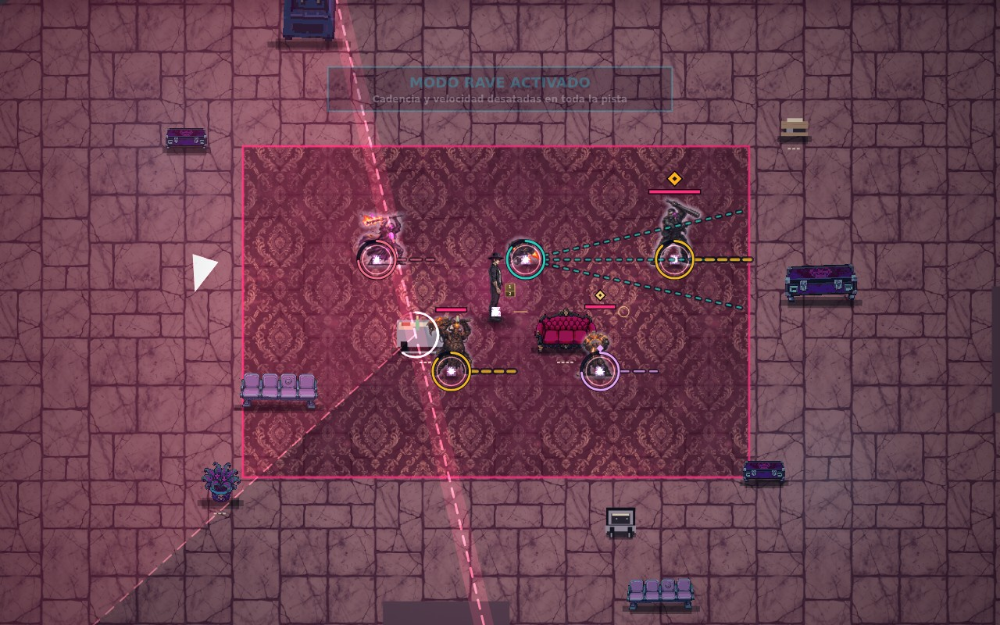

# Hangar-16 · piloto de dibujo activo

**Alcance exacto:** incursión en marcha, planta 0, nodo `r0`, arquitectura nativa `Rs.baseId72 === 'wide'`. Semilla 0 reproduce el caso. Un `r0` compacto y los demás nodos, incluso si usan material *wide*, conservan su render anterior. No hace falta debug para que se pinte el piloto.

`src/dd_hangar_pilot.js` dibuja tapas, caras, jambas y umbrales del compilador. `src/dd_world_renderer.js` conserva el suelo original pero sale antes de pintar la fachada continua en este caso. El adaptador de `tools/build_active_html.py` recompone la caché al cambiar de sala o reinstalarse las puertas. La hoja sellada usa el desbloqueo y tiempo de apertura reales. El origen y la luz vienen de la puerta, no del sprite. La línea física nativa del perímetro **continúa por la abertura**: el motor efectúa la transición, no se camina fuera del polígono. No se modifica esa colisión.

La caché no guarda muebles. Los muebles de suelo visibles se pintan con el pintor nativo por su `sortY`, junto con actores, y no se pinta un mueble intacto si está roto. El tinte RAVE y los efectos no deciden impactos. Solo en esta sala se dibujan el sector de láser (`rf`) y trayectorias, rombo y anillos temporales (`Wf`) al final de la capa mundo, una sola vez, después de la cobertura. Conservan sus temporizadores y el recorte nativo de trayectorias; que una línea termine ante un obstáculo no significa que el pintor la haya ocultado.

## Revisión reproducible

1. Abrir `/?roomDebug&roomSeed=0`, descender y consultar `DD_ROOM_DEBUG.pilot()`. Debe indicar `active:true`, `meshKey:'r0'`, diez tramos. `DD_ROOM_DEBUG.architecture()` devuelve los intervalos y las bases actuales, no las de la visita anterior.
2. `DD_ROOM_DEBUG.pilotColliders(true)` superpone el auditor **nativo**. Verificar los bordes interiores de las jambas contra el umbral, despejar y cruzar; fuera del ancla la superposición piloto se desactiva. Volver y comparar las bases rotas con `fixtures.filter(p=>p.broken)`. Desactivar con `pilotColliders(false)` antes de juzgar el color de los avisos.
3. En RAVE, comparar `warnings[].remaining` y `laser.elapsed/warning` con los anillos; distinguir sprint coral, carga ámbar, abanico turquesa, élite con rombo violeta y sector láser con flecha. Revisar juntos y por separado, delante/detrás de cobertura y próximo a las jambas.

[Detalle del corte con el auditor físico activo](piloto/cut.jpg). El verde discontinuo es el límite de contención, no una pared pintada.

## Qué se comprobó

`node tools/qa/hangar_pilot.cjs http://localhost:8000 [carpeta-capturas]` pasó en Chromium. La prueba inserta mesa y sofá en un perfil desechable, comprueba su bloqueo, aplica impactos con la rutina nativa hasta romperlos y comprueba que dejan de bloquear. Coloca al jugador cerca de la puerta y ejerce el detector direccional real en `r0 → r1 → r0` tras despeje de QA. La pared se recompone igual y los muebles siguen rotos y no sólidos. Segunda semilla: el piloto permanece apagado en la entrada compacta. Los preparativos de la prueba no se distribuyen en el juego.

La captura es del canvas real con RAVE activo y **avisos preparados**: incluye tanque, minijefe, altavoz, sprint, élite y láser. Se muestrearon dos fases del aviso con tiempos controlados. Esto verifica composición y estado; no es una partida espontánea ni una medida de tiempo de reacción. Pasaron también `room_generation_live.cjs` y `dice_engine.cjs`.

**Antes de ampliar:** completar el cruce con controles físicos y desde ambos laterales del hueco; comprobar lectura en movimiento, HUD completo, pantalla pequeña, movimiento reducido, densidad alta y láser atravesando el encuadre. Medir P95 en hardware objetivo. No extender a otra arquitectura hasta verificar que el jugador distingue dirección y momento de peligro en esas condiciones.

**Medición previa a la ampliación:** [protocolo de lectura, captura P95 y criterios](MEDICION_HANGAR.md).
