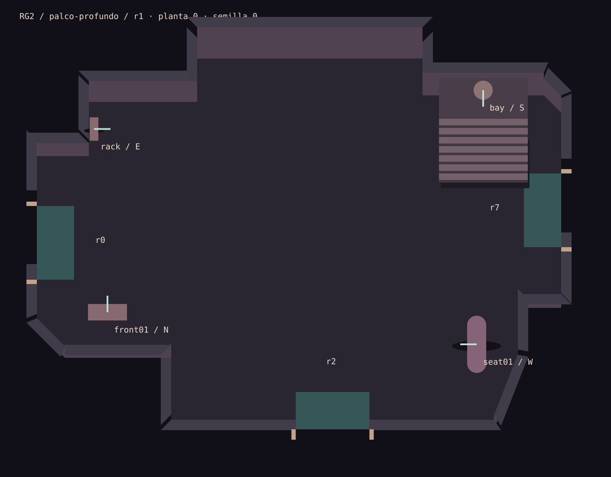

# Salas prefabricadas · ensamblador RG2 / v1



**Integración entregada:** al generar una planta real, cada nodo recibe `prefab:{version,template,connections}` después de cerrar el grafo. No son 16 salas independientes de un ejemplo: se ensamblan todas las plantas, incluida la cámara final sin salida. La elección usa un canal de semilla independiente por planta y clave, sin tocar `Math.random` ni la secuencia de combate. **Actualización jugable:** las cinco casas del catálogo se instalan en los 108 nodos jugables de la incursión (el 109 es la entrada `r0` de la planta 0, que conserva el piloto Hangar-16). Cada nodo recibe su casa según su función y su semilla, y la planta entera se regenera con el mismo resultado tras recargar. El relieve de cabina y peldaños es óptico: el combate no tiene una segunda altura física.

## Probarlo

En `/?roomDebug&roomSeed=0`, iniciar la incursión y ejecutar `DD_ROOM_DEBUG.prefab('r1')`. Sin argumento inspecciona la sala actual. `DD_ROOM_DEBUG.current().nodes.map(n=>[n.key,n.prefab])` muestra los contratos de toda la planta. El inspector devuelve datos, no viaja ni fuerza oleadas.

```sh
node tools/prefabs/inspect.cjs 0 0 r1  # plano completo: malla, umbrales, frentes, alturas, peldaños y bases
node tools/prefabs/proof.cjs 0 0 r1 > /tmp/r1.svg
node tools/prefabs/brief.cjs 0 0 r1   # prompts finales por pieza y por estado
node tools/qa/prefab_floors.cjs
```

## Esquema de autoría

El [catálogo JSON](../../../src/room_generation/prefabs/catalog.json) es la entrada; [prefabs.js](../../../src/room_generation/prefabs.js) y `compileArchitecture` son los compiladores. Los índices `x,y` del **grafo** siguen siendo discretos; no limitan el suelo a celdas. Cada sala tiene su propio espacio local, X hacia este, Y hacia sur. Las salas se conectan por transición, no superponiendo dos sistemas de coordenadas.

| Campo | Contrato |
|---|---|
| `perimeter[]` | Bucle simple horario de `[nombreSegmento,x,y,altura]`. El vértice siguiente es el fin del segmento. Cóncavos, retornos y chaflanes; sin aristas de longitud cero. La altura extruye la cara desde la base; sombra hacia sureste proporcional a la altura, nunca collider. |
| `sockets` | Segmento candidato por lado cardinal, **no puerta**. Dejar en su centro ancho de 170 más 10 por jamba y libre el carril de llegada. Se materializa solo si `links` apunta al vecino; el residente ordinario usa el primer lado libre del orden nativo para el ascensor real. El Núcleo no genera ascensor. |
| `decks[]` | ID, base `x,y,w,h`, `rise`, número de peldaños, avance `run`, aproximación sur en v1. Cada peldaño devuelve base, cota superior y altura de contrahuella; no simular escalera con rayas en la textura. |
| `placements[]` | `edge,t,inset` anclan centro de base sobre tangente/normal. `asset` hereda la referencia del jugador, frontal nativo, huella, solidez y destructibilidad. `facing:inward` exige soporte cardinal; en chaflán usar frente cardinal explícito o no montar el asset. `readingDepth` produce una franja desde la cara, no una acción. |
| `assets` | Definiciones de mesa rectangular, sofá cápsula, monitor circular, panel ambiental y puesto. Tamaño visual expresado en anchos/altos de jugador; referencia de autoría **64 × 96**, no cápsula de daño. `normal`, `view`, `yaw`, `artSize`, sombra, cota y `sortY` se resuelven por instancia. |

## Ejemplo y encadenamiento

Cinco casas cubren el club: `nave-quebrada` (1 210 × 770, alcoba de monitores al NE elevada 30 u, cinco peldaños) y `palco-profundo` (1 210 × 855, cuello norte desplazado, ala sur larga y cabina a 42 u con siete peldaños) son los palcos; `pasillo-servicio` (1 720 × 700) es el corredor largo con pasarela al oeste, para pasillos y retos; `arena-octogono` (1 500 × 1 120) es el octógono de ocho muros con tarima al sureste, reservado a las cámaras del residente; y `camarote` (1 080 × 1 000) es el cubículo con nicho noroeste y palco elevado, para tienda, descanso y secretos. La asignación es por función: residente → octógono, pasillo → corredor, tienda/descanso/secreto → camarote, y el resto sortea entre palcos y corredor con el canal `prefab-v1:<clave>`, así que dos partidas con la misma semilla repiten el reparto. En la semilla 0, planta 0, `r1` y `r2` usan **pasillo-servicio**, `r3` **palco-profundo** y `r4` **nave-quebrada**. El ejemplo incluye un puesto con franja frontal **de lectura**, sin tienda nueva. La proyección superior adjunta utiliza los conectores efectivamente resueltos, no los cuatro sockets potenciales.

Una abertura comparte origen, tangente y normal para tapa cortada, jambas, suelo y llegada. No homogeneizar los dos alcances del motor: uso a 137 u, cruce direccional a 86 u salvo ascensor, llegada a 150 u al interior. Bloqueos, tiempos, tienda, visita y transición siguen siendo responsabilidad de RG2. Para añadir una plantilla, declarar cuatro soportes compatibles con holgura, añadir piezas fuera de los corredores, mantener la salida del ascensor libre y ejecutar los tests antes de incluirla en la selección. Versionar el catálogo si cambia el conjunto o su orden.

## Arte y aceptación

La [orden de arte de r1](orden-palco-r1.md) se genera del plano real. El estado roto solo se solicita para piezas destructibles. Modelar cada frontal con su orientación de mundo y exportar la vista cardinal correspondiente: **0° sur, 90° oeste, 180° norte, 270° este**. Sin rotación heredada ni giro del PNG vertical en pantalla. Mantener el pivote en la base en todas las variantes. El render ordena por apoyo de suelo, no por altura de la imagen; ninguna imagen decide impactos. Los prompts definen entregables: no son un paquete de sprites ya pintados.

Prueba automática: 654 instancias / 60 plantas, veinte corredores casa-lado con margen (cinco casas × cuatro lados), correspondencia de enlaces recíprocos, ascensor y núcleo, invariancia del resto del plan nativo. Chromium verificó `prefab()` en dos entradas con semilla controlada. Esto no certifica combate en estos colliders. Antes de activarlos: validar movimiento/tiro/retorno de ambos lados, rotura y revisita, spawns por el Director, RAVE con sprint coral, carga ámbar, altavoz turquesa, élite violeta y sectores láser rojos sobre la escena terminada. El catálogo no genera peligros ni cambia sus temporizadores. Conserva la puerta de rendimiento y lectura de Hangar-16.

**Arte por ubicación y estado:** [fichas de palco r1 y nave r2](FICHA_SPRITES.md) · [prompts individuales](prompts-sprites.md).

## Integración visual aislada de los lotes 01 + 02

Servir el repositorio y abrir `/previews/prefabs/`, o ejecutar `python previews/prefabs/serve.py` (puerto 8014). [Captura de r1](montaje-lotes.jpg). Cambiar entre **r1** y **r2**, acercarse a la escalera, mueble o umbral desde **Encuadre** y alternar **Cobertura rota** sin mover cámara ni pivote. **Pivotes / frentes** enseña el apoyo proyectado y la cara útil. No es un modo de juego ni activa puertas, destrucción o daño. Las texturas y sprites provienen directamente de los dos kits; no se copian ni se registran en el manifiesto activo.

`node tools/prefabs/export-preview.cjs` regenera las dos salas de revisión (semilla 0). `node tools/qa/prefab_art_preview.cjs http://localhost:8000` prueba el visor en Chromium. Esta integración no sustituye la prueba de avisos de RAVE con jugador ni valida la física de perímetros cóncavos.

### Inspección de profundidad y proporción

Activar **Figura patrón** y elegir **Tarima / escalera**. Usar el deslizador para subir desde el suelo hasta +42 u (r1) o +30 u (r2); con **Reproducir** el recorrido dura seis segundos y se puede pausar. La proyección de la figura original y su sombra usan la cota del peldaño bajo los pies. La figura entra en la misma cola de profundidad que los muebles. Enfocar el sofá o la mesa para rodear su base y alternar **Cobertura rota** sin cambiar la fase. En un umbral, la figura se acerca desde el interior sin activar ninguna puerta. **Planta completa** conserva el recorrido de la escalera. La referencia es un patrón óptico, no un jugador simulado: no prueba colisiones, combate, control ni lectura de avisos RAVE.

[Detalle de la tarima con la figura patrón](prueba-cota.jpg)

## Entrar en las salas instaladas

Abrir el juego normal, bajar desde el Refugio y avanzar por la primera planta. No hace falta abrir el visor. Para inspección reproducible abrir `/?roomDebug&roomSeed=0`: r1 y r2 usan **pasillo-servicio**, r4 **nave-quebrada**, r9 **camarote** y la cámara del residente **arena-octogono**. Fuera de esa semilla se respeta la asignación determinista de RG2. [Captura de la incursión en r2](r2-jugable.jpg).

`playable.js` entrega el perímetro y los anclajes de puerta al instalador nativo; el motor ya dispone de la ruta de colisión para polígonos no convexos. El adaptador construye las bases con `mc/gc`, en lugar de superponer la población escénica anterior. `dd_prefab_world.js` pinta las piezas reales de `assets/prefabs/club` y consulta `broken` de cada objeto. Dos piezas de sitio nuevas, el difusor frontal del tramo `balcony` y la canaleta de la tarima, son decorativas y no añaden obstáculos ni puntos de uso. El Director conserva su veto de posiciones de aparición.

`node tools/qa/playable_prefab.cjs http://localhost:8000` comprueba r0 → r1 → r2 → r1 mediante despeje/cruce de QA, correspondencia entre puertas y malla, exclusión de un entrante, aparición en r2 y persistencia de un sofá roto por la rutina nativa. No certifica FPS en hardware físico, juego humano ni legibilidad en RAVE.

## Despliegue al juego completo

El instalador aplica las dos plantillas a 108 de los 109 nodos de una incursión completa. La excepción es la entrada r0 de la primera planta (incluye el piloto Hangar-16). Las plantas posteriores mezclan la piedra propia del círculo con el suelo de la cabina. `node tools/qa/prefab_rollout.cjs` inspecciona las puertas y el mobiliario reales mediante entrada directa de QA a los 108 nodos de la semilla 0; no simula terminar la campaña. El validador de decoración aleatoria puede señalar los muebles adosados como demasiado próximos a la pared; la inspección de instalación no certifica el equilibrio de combate.

El Refugio activo comparte el plano orgánico, las placas, el pintor y el relieve con el estudio del vestíbulo. Su escala es 2×; el movimiento, los disparos de ensayo, el mapa, las áreas de uso y la selección de estaciones se resuelven en coordenadas de juego. El estudio sigue disponible por separado para comparar, no como paso de entrada al juego.

### Qué comprueba y qué no

`tools/qa/prefab_rollout.cjs` entra en los 108 nodos con la entrada directa de QA y exige: puertas conectadas al socket real, todo el mobiliario instalado, la oleada presente en salas de combate, ningún enemigo dentro de un mueble sólido, botín y torretas fuera de los sólidos y cada punto de aparición dentro del polígono. Registra además el linter genérico de decoración: lo incumplen las 108 salas porque los mostradores se montan a ras de barandilla a propósito y la regla pide 110 px de holgura alrededor de cada mueble sólido. La circulación se verifica aparte con los 8 corredores de aproximación de `prefab_floors.cjs` y el recorrido de `refuge_walkthrough.cjs`; el linter no se usa como criterio de aceptación.

`tools/qa/prefab_perf.cjs` mide cadencia real del planificador en 6 salas nuevas (plantas 2 y 5, 8–17 enemigos): 35–49 ms de media y 50–67 ms de p95 en Chromium headless con GL por software, el mismo orden que el piloto Hangar en ese entorno. La propia carcasa arquitectónica cuesta 0,9 ms por fotograma, así que el coste dominante es la composición del lienzo, no el arte nuevo. En hardware con GPU está por medir.

### Descenso y persistencia

`tools/qa/prefab_progression.cjs` recorre la ruta principal de **los nueve descensos**, del círculo I al núcleo: exige que la puerta del ascensor caiga sobre su hueco del prefab (misma pared, mismo origen, aterrizaje libre), despeja las salas obligatorias, comprueba que la puerta del ascensor se abra de verdad y desciende con `kg()`, la misma función que invoca la puerta (`wg` → `kg`). En cada llegada exige la malla montada y que todos los nodos de la planta lleven prefab; el núcleo es un fondo de saco legítimo, con muros y tarima pero sin aberturas, así que ahí solo se exige malla. Después recarga la página y compara la asignación de prefabs de los diez círculos: el círculo en curso no forma parte del guardado —el juego reinicia la incursión—, pero `dmo_floor_v32` debe reconstruir exactamente las mismas plantas.

Evidencias en `ART_EVIDENCE/PREFABS_ROLLOUT/`: `planta-02.jpg` (lujuria), `planta-05.jpg` (ira), `planta-10-nucleo.jpg` (arena del residente) y `refugio.jpg` (vestíbulo activo con la galería al oeste y el descenso al norte).

### Cinco casas en juego

`ART_EVIDENCE/PREFABS_ROLLOUT/casa-pasillo-servicio.jpg`, `casa-camarote.jpg`, `casa-tienda.jpg`, `casa-arena-octogono.jpg`, `planta-02.jpg`, `planta-05.jpg`, `planta-10-nucleo.jpg` y `refugio.jpg` están tomadas del juego normal, no del visor. El suelo de cada círculo usa su propia piedra teñida al tono de la sala; el círculo I deja de ser una losa clara y las siluetas hostiles mantienen su contraste. La cámara del residente tiene seis muebles en lugar de cuatro porque su planta es un 60 % mayor.

La suite que lo comprueba: `prefab_floors.cjs` (20 corredores), `prefab_rollout.cjs` (108 salas con puertas, muebles, oleada, botín y puntos de aparición válidos), `prefab_progression.cjs` (nueve descensos con la puerta real, llegada al núcleo y reconstrucción idéntica de las diez plantas tras recargar), `playable_prefab.cjs` (r0/r1/r2 con su malla y la rotura nativa) y `prefab_perf.cjs` (cadencia). Sigue sin certificarse el RAVE saturado ni el rendimiento con GPU real.

### Mostrador y stock

La casa `camarote` monta un `puesto` con franja de lectura al sur (`front01`), así que tienda, descanso y secretos tienen mostrador propio en vez de una mesa suelta; el puesto nativo de la tienda se sigue dibujando donde siempre y las cuatro cartas de venta caen dentro del salón. `prefab_rollout.cjs` comprueba ahora el stock real desde `DMO.explore.state().stock` —cuatro artículos por tienda, dentro del polígono y sin sólidos encima—; la versión anterior leía un campo inexistente del survey y por eso pasaba en vacío, ya corregida.

### Lectura bajo RAVE

`tools/qa/prefab_rave.cjs` monta el mismo fixture que el piloto Hangar —cinco avisos reales en pantalla, láser y RAVE— dentro de una sala de combate de cada casa con volumen propio: `pasillo-servicio`, `nave-quebrada`, `palco-profundo` y `arena-octogono`. La prueba afirma que el medidor de RAVE está activo y que hay cinco o más hostiles en pantalla antes de capturar; no afirma nada sobre estética.

Juicio sobre las capturas de `ART_EVIDENCE/PREFABS_RAVE/`: en las cuatro casas el láser magenta, los anillos de aviso y las siluetas hostiles se separan del suelo teñido, incluso en el octógono, que es la planta más grande y la de piedra más clara. La casa `camarote` queda fuera del fixture a propósito: solo aloja tienda, descanso y secretos, donde el RAVE no llega a activarse. Las capturas son de la build servida en el puerto 8015 con la semilla 0.

Esto es una comprobación visual mía sobre cuatro fotogramas forzados, no una prueba de legibilidad con jugadores reales ni con la pista saturada de enemigos.

### Teléfono y mando táctil

`tools/qa/prefab_touch.cjs` abre el juego en 390 × 720 con `isMobile` y toques reales por CDP sobre la zona de movimiento: arrastra el joystick en una sala de combate de cada casa con volumen propio y exige que el corredor se desplace más de 40 px y siga dentro del polígono. Los cuatro fotogramas de `ART_EVIDENCE/PREFABS_TOUCH/` son la evidencia.

Dos arreglos de HUD salieron de ahí, ambos en `src/dd_rebuild_ui.css`: la torre de progresión (196 × 132) tapaba media cabecera en pantallas de 390 px —ahora mide 112 × 76 por debajo de 520 px— y el cartel del círculo cruzaba la fila del dado, así que pasa a dos líneas con 50vw de ancho y se separa 48 px. Sin esos dos cambios, en el móvil se leían mal la vida, el escudo y el dado. Lo que sigue igual de apretado es la franja de ronda sobre los botones de habilidad; es anterior a este trabajo y no la toqué.
